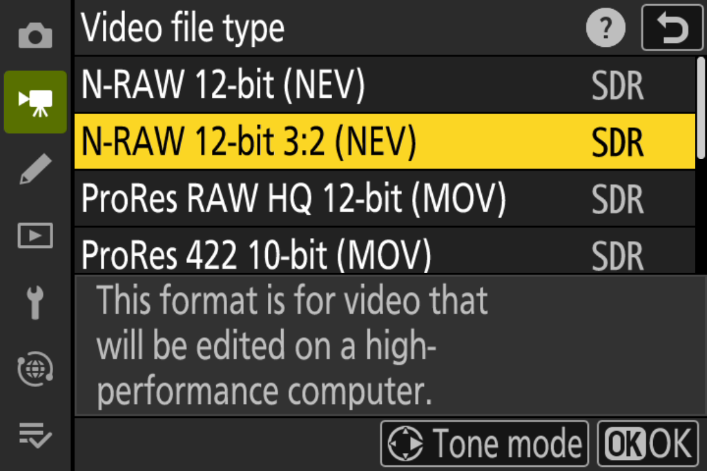
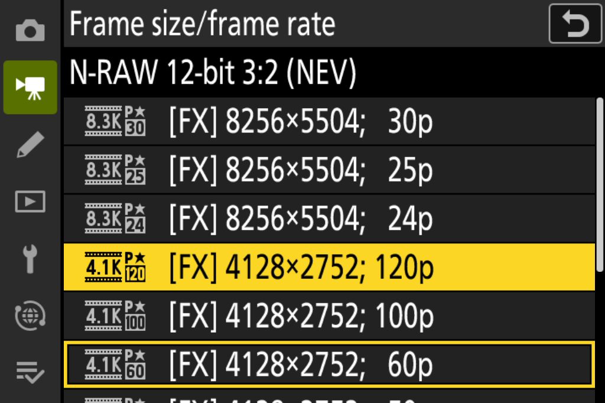
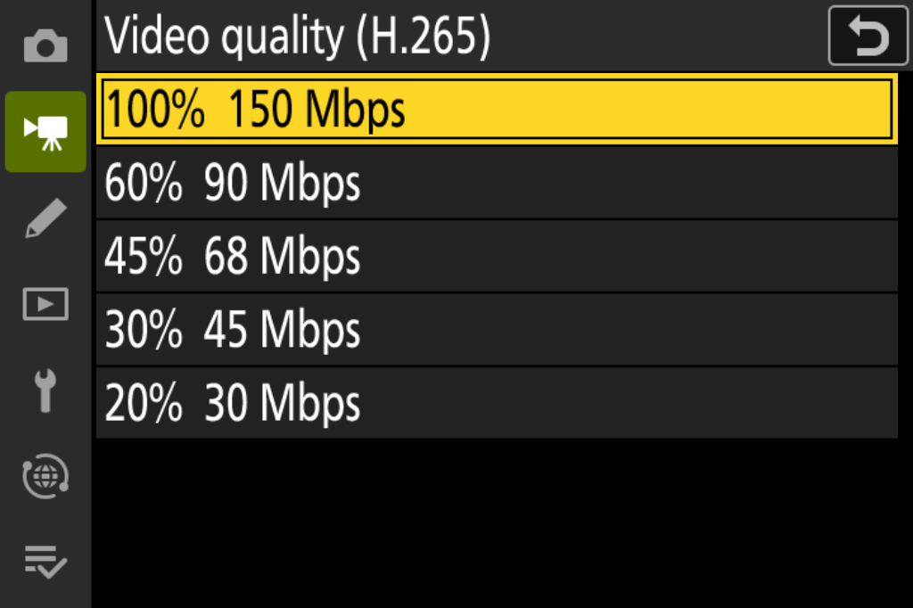
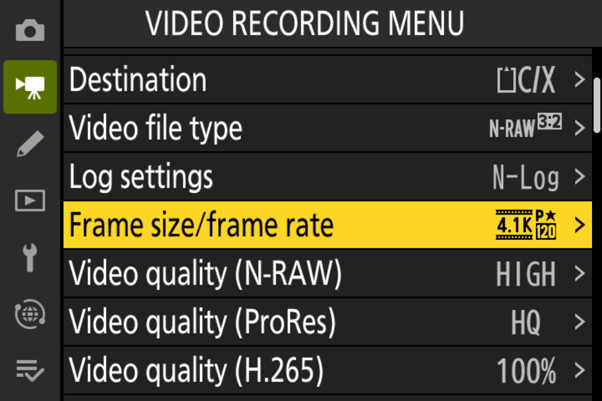
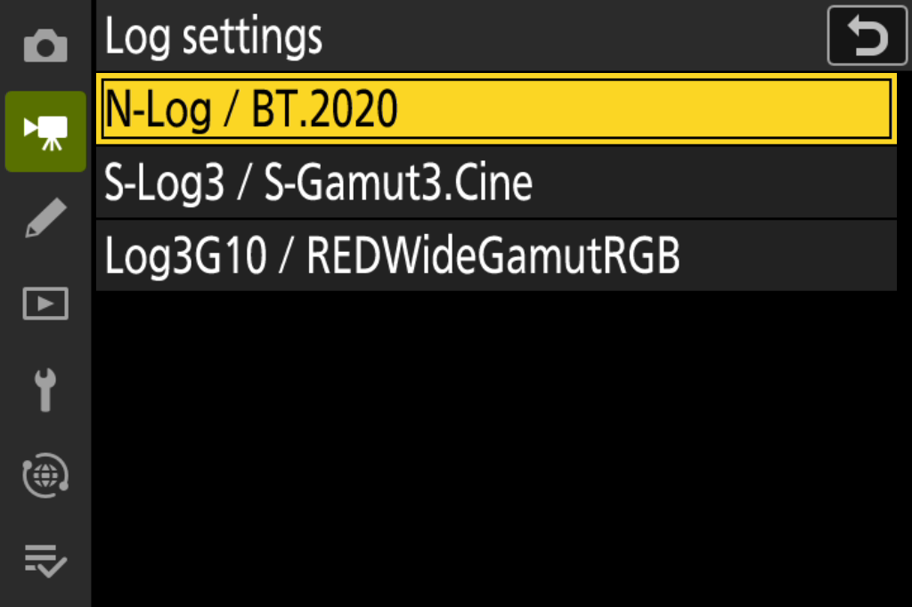
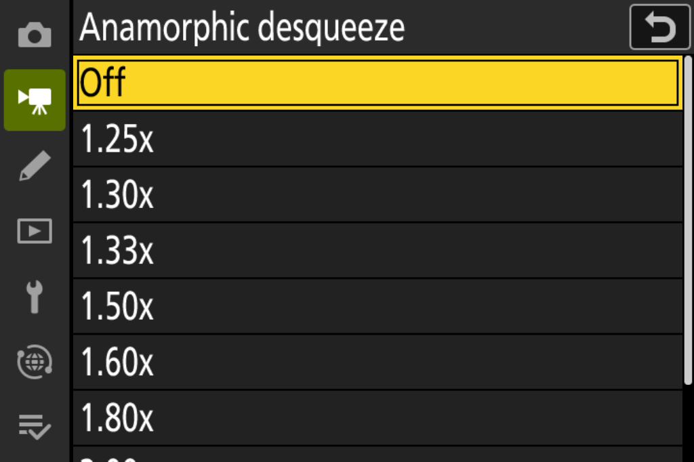
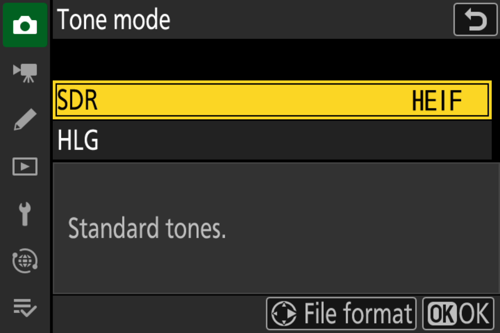
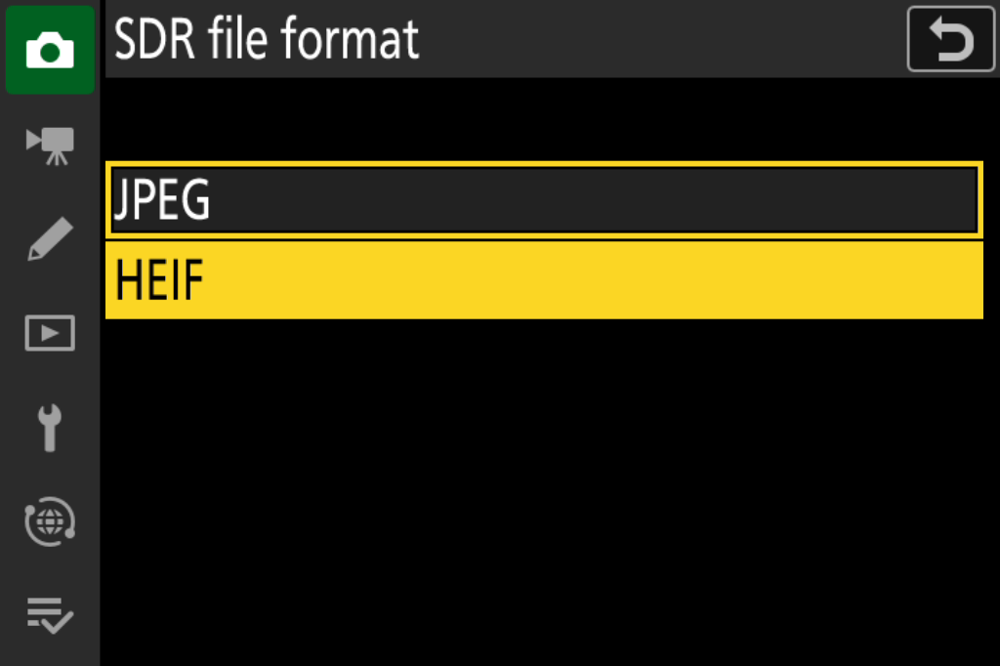
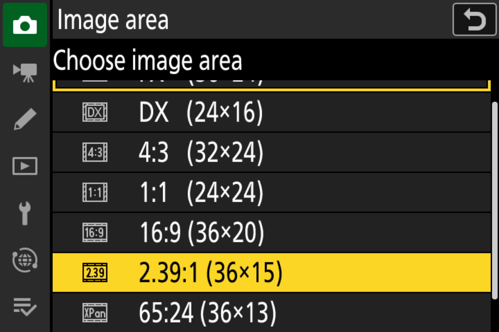
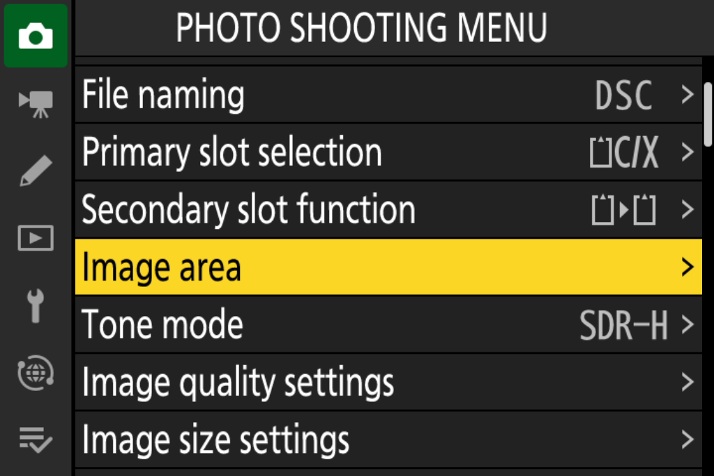

# NikonFirmwarePatch — Nikon Z8 功能扩展

[简体中文](#简体中文) · [English](#english) · [功能预览 / Preview](#功能预览--feature-preview) · [介绍视频 / Intro video](https://www.bilibili.com/video/BV1siygzeEDW/) · [Changelog](CHANGELOG.md)

## 功能预览 / Feature preview

英文模拟器菜单，点击可查看原图。Select a panel to view the original emulator screenshot.

| **N-RAW 3:2 文件类型 / N-RAW 3:2 file type** | **N-RAW 3:2 画面尺寸 / N-RAW 3:2 frame sizes** | **N-RAW 四档 / N-RAW quality tiers** |
|---|---|---|
| <a href="docs/images/video-file-type-nraw32.png"></a> | <a href="docs/images/opengate-frame-rates.png"></a> | <a href="docs/images/nraw-quality-tiers.png"></a> |
| **ProRes 画质 / ProRes quality** | **H.265 码率 / H.265 bitrate** | **视频菜单取值 / Saved video settings** |
| <a href="docs/images/prores-quality-options.png"></a> | <a href="docs/images/h265-bitrate.png"></a> | <a href="docs/images/video-menu-values.png"></a> |
| **Log 与色域 / Log and gamut** | **反挤压倍率 / Desqueeze factor** | **SDR HEIF 色调模式 / Tone mode with SDR HEIF** |
| <a href="docs/images/log-settings.png"></a> | <a href="docs/images/desqueeze-options.png"></a> | <a href="docs/images/tone-mode-heif.png"></a> |
| **SDR 文件格式 / SDR file format** | **照片裁切比例 / Still crop ratios** | **照片菜单取值 / Saved photo settings** |
| <a href="docs/images/sdr-heif-format.png"></a> | <a href="docs/images/image-area-crops.png"></a> | <a href="docs/images/photo-menu-values.png"></a> |

## 简体中文

Nikon Z8 C 3.11 实验补丁的离线构建工具。提供四组可独立选择的功能，并可一次构建任意组合。本版为 **v0.5.1**，修复 v0.5.0 中 N-RAW 4.1K 3:2 的取景冻结、录制中触屏对焦卡顿和取景器回放花屏，见[更新日志](CHANGELOG.md)。v0.5.0 新增了 N-RAW 4.1K 3:2（最高 120p）、SDR HEIF 和三种照片裁切比例，功能介绍视频见 [B 站](https://www.bilibili.com/video/BV1siygzeEDW/)。[下载工具包与校验清单](https://github.com/XinmiaoZhao/NikonFirmwarePatch/releases/tag/v0.5.1)。

**使用风险。** 这是实验固件，构建或安装可能造成数据丢失、卡损坏或相机故障。离线检查不等于实机安全保证，请勿用于不可替代的工作。无担保及责任条款见 [LICENSE](LICENSE) 和 [NOTICE](NOTICE.md)。

| 构建选项 | 功能 |
|---|---|
| `video-recording` | N-RAW 12位 3:2（8.3K 30／25／24p，4.1K 120p 至 24p）、N-RAW 四档、反挤压显示、ProRes HQ／422／LT／Proxy 及 HQ 星标、H.265 五档码率 |
| `log-colour` | Log 菜单选择 N-Log／BT.2020、S-Log3／S-Gamut3.Cine、Log3G10／REDWideGamutRGB，含标签、图标和显示辅助 |
| `still-photo-tools` | SDR HEIF（10 位 `.HIF`）、4:3／2.39:1／65:24 照片裁切、机内像素位移合成 |
| `raw-precapture` | C15/C30 RAW 预拍（FX/DX，HE／HE★，画质沿用普通菜单） |

N-RAW 3:2 是单独的视频文件类型，ProRes 与 H.265 仍为 16:9；反挤压可关闭。SDR HEIF 与新增画幅用于普通照片。SDR HEIF 的写法针对 macOS、iPhone、Windows 11 照片和小米相册做了适配，见 [SDR HEIF 兼容性](docs/sdr-heif.md#兼容性)；新增画幅在照片菜单、i 菜单和指定的 Fn 键中均可选择。C15 至 C120 的压缩照片使用 JPEG，C15/C30 预拍沿用原有 FX/DX 和 NEF／JPEG 输出。像素位移合成需要完整的 FX 无损 NEF 组，预拍输出不适用。Log 录像使用经实拍标定的矩阵与常量 Cpxs；S-Log3 沿用原厂截零，Log3G10 录像不含 RED 的 F 映射。刷入其他固件之前，请先把照片的图像区域改回 FX。

四组有 15 种非空组合。v0.4.0 的 `framing / video-quality / photo-tools` 和更早的 `prores / precapture / pixelshift / opengate-nraw` 都不被当前 CLI 接受，也不会静默换成新组；新旧组的对应见[四组说明](docs/feature-groups.md)。需要复现旧包时使用对应旧发布源码与工具包。

### 获取固件与工具包

下载 [toolkit ZIP](https://github.com/XinmiaoZhao/NikonFirmwarePatch/releases/download/v0.5.1/NikonFirmwarePatch-v0.5.1-toolkit.zip)，按 [SHA256SUMS.txt](https://github.com/XinmiaoZhao/NikonFirmwarePatch/releases/download/v0.5.1/SHA256SUMS.txt) 核对后解压。工具包含有构建和核验固件所需的全部文件，即源码、配方、测试和二十个经审阅的预编译补丁单元，另附许可证和文字说明。截图和色彩报告不在工具包内，请在 GitHub 上查看，或下载同一版本的 Source code 归档。GitHub 自动生成的 Source code 归档和 Git 克隆不带预编译单元。工具源码、预编译单元及配方须来自同一版。

同一 release 另有两个附件，校验值同样列在 SHA256SUMS.txt：

- [后期 F LUT](https://github.com/XinmiaoZhao/NikonFirmwarePatch/releases/download/v0.5.1/NikonFirmwarePatch-v0.5.1-F-LUT.zip)：65³ `.cube`，附文件身份、数值核验和使用说明，用法见 [LUT 说明](luts/README.md)。
- [macOS app](https://github.com/XinmiaoZhao/NikonFirmwarePatch/releases/download/v0.5.1/NikonFirmwarePatch-v0.5.1-macOS.dmg)：图形界面的构建工具，内置同一版工具包，适用于 Apple 芯片、macOS 14 或更高，见 [Mac app 说明](docs/macos-app.md)。

请自行取得 [Z8 C 3.11 原厂固件](https://web.archive.org/web/20260921081340id_/https://download.nikonimglib.com/archive8/wP5Vr003qbpC07ibhJ666rmRfF47/Z_8_0311.bin)，并遵守尼康的许可条款。尼康已撤下 C 3.11 的说明页和下载链接，现在只提供 C 3.12；上面的链接是 Internet Archive（Wayback Machine）保存的尼康原始下载，原说明页及其许可条款见[原说明页的 Wayback 快照](https://web.archive.org/web/20260920232234/https://downloadcenter.nikonimglib.com/en/download/fw/606.html)。文件从哪里取得都可以，工具会先核对下面的长度和 SHA-256。背景见 [issue #11](https://github.com/XinmiaoZhao/NikonFirmwarePatch/issues/11)。

### 构建与核验

输入必须是用户自行取得的**完整原厂 Z8 C 3.11** `Z_8_0311.bin`，99,051,117 字节，SHA-256：

```text
d67413c2ede6b9ce8887175f20700bd9fbad2a973a4820968c45503d15d80d96
```

不支持 C 3.12，不接受已经打补丁的固件。仓库不包含原厂固件、相机素材或运行库。工具只生成本地文件，不访问存储卡、不更新相机。

需要 Python 3.10+。从解压的工具包目录操作。macOS／Linux 建立虚拟环境：

```sh
python3 -m venv .venv
source .venv/bin/activate
```

Windows PowerShell 可用以下命令（示例选择 Python 3.12）：

```powershell
py -3.12 -m venv .venv
.\.venv\Scripts\Activate.ps1
```

激活后安装工具包固定的依赖：

```sh
python -m pip install -r requirements.txt
```

检查输入：

```sh
python patch.py Z_8_0311.bin --check
```

以下命令使用工具包的默认预编译模式。直接从 Git 源码构建时，在构建命令末尾加 `--code-source source --compiler clang`；已核对的编译器为 Apple clang 21.0.0（clang-2100.1.1.101）。其他编译器须产生相同字节、符号与入口地址。缺少或损坏预编译单元时工具会停止。

```sh
# 单独构建视频录制组。
python patch.py Z_8_0311.bin --features video-recording --version 04.08 --tag p0 --output build/video

# 全选四组，版本号用于标识本次输出。
python patch.py Z_8_0311.bin --features video-recording log-colour still-photo-tools raw-precapture --version 04.08 --tag p0 --output build/all
# v0.5.1 四组全选、版本 04.08、tag p0：build/all/Z_8_0408.bin 的 SHA-256
# 73a151f7ce1f033a5eaadb44cfcf5e37c74bc250addc7841061a3a606fc4bab5

# 交互选择四组；预编译工具包默认不调用编译器。
python patch.py Z_8_0311.bin --interactive --version 04.08 --tag p0 --output build/chosen
```

构建输出为 `.bin`、`manifest.json` 和 `SHA256SUMS.txt`。输出目录必须不存在；输入原件不会被覆盖。本页各命令统一用 04.08 演示。不同功能组合可能使用相同文件名；保留各自的输出目录，按 manifest 中的功能清单和 SHA-256 区分。实际上机时建议给不同内容分配不同身份。`00.xx.t0` 仅用于离线测试，不能作为上机包。

独立核验示例：

```sh
python verify.py Z_8_0311.bin build/all/Z_8_0408.bin --features video-recording log-colour still-photo-tools raw-precapture --version 04.08 --tag p0
```

`verify.py` 不导入构建器，独立检查封装、输入身份、补丁窗口和未改字节，并检查共享菜单、分组可见性、字符串边界与初始化状态。它不能证明相机上的硬件行为。

版本格式为 `NN.NN`，内部 tag 为一个小写字母加一位数字。Z8 支持降级或同版本重刷；恢复时使用此前能正常工作的完整固件包。工具不能读取当前机身版本。每次均从原厂输入选择功能，以新目录接收输出。

### 功能说明与验证

- [四组结构与迁移](docs/feature-groups.md)
- [N-RAW 3:2 与 N-RAW 四档](docs/opengate-nraw.md)、[反挤压](docs/anamorphic.md)
- [ProRes](docs/prores.md)、[H.265](docs/h265.md)
- [Log 设置与后期流程](docs/log-colour.md)、[色彩报告：中文](docs/log-colour-report.md)／[English](docs/log-colour-report.en.md)、[后期 F LUT](luts/README.md)
- [SDR HEIF](docs/sdr-heif.md)、[照片裁切比例](docs/photo-crop.md)、[像素位移合成](docs/pixelshift.md)
- [RAW 预拍](docs/raw-precapture.md)
- [当前验证](docs/validation.md)、[已知问题](docs/known-issues.md)、[更新日志](CHANGELOG.md)

[发布包内容和验证流程](docs/releases.md)列出维护者回归命令；构建组合回归可运行 `python tests/validate_combinations.py --stock /path/to/Z_8_0311.bin --report build/combinations.json`，需要审阅过的源码编译器。

若发现 `Z8PRESTP.BIN` 或预期 RAW 却只写出 JPEG，请停止连拍、等待写入结束，并保留两张卡上的文件。即使空的同名停止文件也会生效。见[停止文件指南](docs/stop-file.md)。

### 色彩测试与后期 LUT

[中文版色彩报告](docs/log-colour-report.md)与[英文版](docs/log-colour-report.en.md)分别展示当前录像与同场 N-RAW 的实拍色差，以及简化矩阵、原厂色相表和恒等 Cpxs 的模拟偏色。当前后期操作见 [Log 设置与 Resolve／FCP 流程](docs/log-colour.md)：明确指定输入色域与曲线，检查自动识别，并避免重复转换。

[65³ 后期 F LUT](luts/README.md)以 RWG／Log3G10 输入和输出，给当前无 F 素材近似补上 RED 解码 N-RAW 时引入的饱和度映射，再接显示变换。LUT 作为 release 附件单独提供：[F LUT ZIP](https://github.com/XinmiaoZhao/NikonFirmwarePatch/releases/download/v0.5.1/NikonFirmwarePatch-v0.5.1-F-LUT.zip)，内含 `.cube`、文件身份、数值核验和使用说明。生成脚本和核验程序在仓库中。

源码和自编译补丁采用 GPL-3.0-only。Nikon 固件适用其原有许可。本项目与 Nikon 无隶属关系。见 [LICENSE](LICENSE)、[NOTICE](NOTICE.md)。

## English

This offline toolkit builds experimental patches for the original Nikon Z8 C 3.11 firmware. Select any of four feature groups or combine them in one build. The current release is **v0.5.1**. It fixes the N-RAW 4.1K 3:2 live-view freeze, stalls from touch AF during recording and viewfinder playback corruption in v0.5.0; see the [changelog](CHANGELOG.md). v0.5.0 added N-RAW 4.1K 3:2 up to 120p, SDR HEIF and three still crop ratios. [Download the toolkit and checksums](https://github.com/XinmiaoZhao/NikonFirmwarePatch/releases/tag/v0.5.1).

**Risk of use.** Building or installing experimental firmware can cause data loss, card corruption or camera malfunction. Offline checks cannot guarantee safe operation on a camera. Avoid using experimental firmware for irreplaceable work. See the warranty and liability terms in [LICENSE](LICENSE) and [NOTICE](NOTICE.md).

| Build group | Included features |
|---|---|
| `video-recording` | N-RAW 12-bit 3:2 (8.3K 30/25/24p, 4.1K 120p to 24p), four N-RAW tiers, anamorphic desqueeze, ProRes HQ/422/LT/Proxy with an HQ star, five H.265 bitrates |
| `log-colour` | N-Log / BT.2020, S-Log3 / S-Gamut3.Cine or Log3G10 / REDWideGamutRGB, with labels, icons and view assist |
| `still-photo-tools` | SDR HEIF (10-bit `.HIF`), 4:3 / 2.39:1 / 65:24 still crops and in-camera pixel-shift merge |
| `raw-precapture` | C15/C30 RAW pre-capture in FX/DX with HE/HE★, using the ordinary quality menu |

N-RAW 3:2 is a separate movie file type; ProRes and H.265 stay 16:9, and desqueeze can be turned off. SDR HEIF and the added image areas apply to ordinary photos. SDR HEIF is written to display correctly in macOS, iPhone, Windows 11 Photos and the Xiaomi gallery; see [SDR HEIF compatibility](docs/sdr-heif.md#compatibility). The added areas are available in the photo menu, the i menu and an assigned Fn button. C15 through C120 use JPEG for compressed photos, and C15/C30 pre-capture keeps its FX/DX and NEF/JPEG output. Pixel-shift merging requires a complete group of lossless FX NEFs, which excludes pre-capture output. Log recording uses camera-calibrated matrices and constant chroma compensation (Cpxs). S-Log3 retains stock clipping at zero; Log3G10 recording omits RED’s F mapping. Return the photo image area to FX before installing other firmware.

There are 15 nonempty combinations. The current CLI rejects the v0.4.0 names `framing / video-quality / photo-tools` and the earlier `prores / precapture / pixelshift / opengate-nraw` rather than substituting new groups; [the group guide](docs/feature-groups.md#english) maps old groups to new ones. To reproduce an earlier package, use that release’s source and toolkit.

### Get the firmware and toolkit

Download the [toolkit ZIP](https://github.com/XinmiaoZhao/NikonFirmwarePatch/releases/download/v0.5.1/NikonFirmwarePatch-v0.5.1-toolkit.zip), check it against [SHA256SUMS.txt](https://github.com/XinmiaoZhao/NikonFirmwarePatch/releases/download/v0.5.1/SHA256SUMS.txt), then extract it. The toolkit holds everything needed to build and verify firmware: source, recipes, tests and twenty reviewed precompiled patch units, plus the license and text guides. Screenshots and the colour report are not in the toolkit; view them on GitHub or download the Source code archive of the same release. Git clones and GitHub’s automatic source archives do not include the precompiled units. Use tools, patch units and recipes from the same release.

The release has two more downloads, also listed in SHA256SUMS.txt:

- [Post-production F LUT](https://github.com/XinmiaoZhao/NikonFirmwarePatch/releases/download/v0.5.1/NikonFirmwarePatch-v0.5.1-F-LUT.zip): the 65³ `.cube` with its identity record, numerical checks and guide; see the [LUT documentation](luts/README.md).
- [macOS app](https://github.com/XinmiaoZhao/NikonFirmwarePatch/releases/download/v0.5.1/NikonFirmwarePatch-v0.5.1-macOS.dmg): a graphical builder with the same toolkit inside, for Apple silicon and macOS 14 or later; see the [Mac app guide](docs/macos-app.md).

Obtain the [original Z8 C 3.11 firmware](https://web.archive.org/web/20260921081340id_/https://download.nikonimglib.com/archive8/wP5Vr003qbpC07ibhJ666rmRfF47/Z_8_0311.bin) under Nikon's license terms. Nikon has withdrawn the C 3.11 landing page and its downloads and now offers only C 3.12. The link above is Nikon's original download as preserved by the Internet Archive (Wayback Machine); the [Wayback snapshot of the original instructions](https://web.archive.org/web/20260920232234/https://downloadcenter.nikonimglib.com/en/download/fw/606.html) preserves the landing page and its license terms. Any copy will do: the tool checks the length and SHA-256 below first. See [issue #11](https://github.com/XinmiaoZhao/NikonFirmwarePatch/issues/11) for the background.

### Build and verify

Use the complete, original Z8 C 3.11 file `Z_8_0311.bin` (99,051,117 bytes). Its SHA-256 is

```text
d67413c2ede6b9ce8887175f20700bd9fbad2a973a4820968c45503d15d80d96
```

C 3.12 and previously patched inputs are unsupported. The repository excludes original firmware, camera media and runtimes. The tool generates local files only and does not access memory cards or update the camera.

Use Python 3.10+ and work in the extracted toolkit directory. On macOS or Linux, create a virtual environment with

```sh
python3 -m venv .venv
source .venv/bin/activate
```

In Windows PowerShell, the following example selects Python 3.12.

```powershell
py -3.12 -m venv .venv
.\.venv\Scripts\Activate.ps1
```

Activate the environment, then install the pinned dependency.

```sh
python -m pip install -r requirements.txt
```

Check the input firmware.

```sh
python patch.py Z_8_0311.bin --check
```

The commands below use the toolkit’s default prebuilt mode. When building directly from Git source, append `--code-source source --compiler clang` to the build command. The reviewed compiler is Apple clang 21.0.0 (clang-2100.1.1.101). Any other compiler must reproduce the pinned bytes, symbols and entry addresses. Missing or damaged prebuilt units stop the build.

```sh
# Build only the video recording group.
python patch.py Z_8_0311.bin --features video-recording --version 04.08 --tag p0 --output build/video

# Build all four groups; the version identifies the output.
python patch.py Z_8_0311.bin --features video-recording log-colour still-photo-tools raw-precapture --version 04.08 --tag p0 --output build/all
# SHA-256 of build/all/Z_8_0408.bin with v0.5.1, all four groups, version 04.08 and tag p0
# 73a151f7ce1f033a5eaadb44cfcf5e37c74bc250addc7841061a3a606fc4bab5

# Choose groups interactively; prebuilt mode runs without a compiler.
python patch.py Z_8_0311.bin --interactive --version 04.08 --tag p0 --output build/chosen
```

Each build produces a firmware `.bin`, `manifest.json` and `SHA256SUMS.txt`. Choose an output directory that does not already exist. The original input is preserved. All examples use 04.08. Different selections can therefore produce the same filename. Keep their output directories separate and identify each package by the feature list and SHA-256 in its manifest. Assign distinct identities to different packages for camera use. Reserve `00.xx.t0` for offline testing.

Independently verify the full-selection example.

```sh
python verify.py Z_8_0311.bin build/all/Z_8_0408.bin --features video-recording log-colour still-photo-tools raw-precapture --version 04.08 --tag p0
```

`verify.py` checks the container, original input identity, patch windows and preserved bytes independently of the builder. It also checks shared menus, feature visibility, string boundaries and initial state. Hardware behaviour requires camera testing.

The version format is `NN.NN`; the internal tag is one lowercase letter followed by one digit. The Z8 supports downgrades and same-version reinstalls. For recovery, use a complete firmware package that previously worked on the camera. The toolkit cannot read the installed camera version. Always build from the original input into a new output directory.

### Feature guides and verification

- [Four feature groups and migration](docs/feature-groups.md)
- [N-RAW 3:2 and N-RAW tiers](docs/opengate-nraw.md#english) and [desqueeze](docs/anamorphic.md)
- [ProRes](docs/prores.md) and [H.265](docs/h265.md)
- [Log settings and grading workflow](docs/log-colour.md#english), colour report in [Chinese](docs/log-colour-report.md) or [English](docs/log-colour-report.en.md), and [F LUT for post](luts/README.md)
- [SDR HEIF](docs/sdr-heif.md#english), [still crop ratios](docs/photo-crop.md#english) and [pixel-shift merge](docs/pixelshift.md#english)
- [RAW pre-capture](docs/raw-precapture.md#english)
- [Current validation](docs/validation.md), [known limits](docs/known-issues.md) and [changelog](CHANGELOG.md)

[Release contents and verification](docs/releases.md) lists the maintainer checks. Run the combination regression with `python tests/validate_combinations.py --stock /path/to/Z_8_0311.bin --report build/combinations.json` using the reviewed source compiler.

If `Z8PRESTP.BIN` appears or a RAW selection unexpectedly produces only JPEG, stop the burst, wait for writes to finish and preserve the files on both cards. Even an empty stop file takes effect. Follow the [stop-file guide](docs/stop-file.md#english-summary).

### Colour tests and the post-production LUT

The [Chinese](docs/log-colour-report.md) and [English](docs/log-colour-report.en.md) reports compare recorded footage with same-scene N-RAW. They also simulate colour shifts with simplified matrices, the stock hue table and identity Cpxs. The [Resolve and Final Cut Pro guide](docs/log-colour.md#english) explains how to set the input gamut and curve, check automatic identification and avoid applying a conversion twice.

The [65³ F LUT](luts/README.md) takes RWG / Log3G10 input and produces RWG / Log3G10 output. It approximates the saturation mapping introduced by RED’s N-RAW decode for footage recorded without F. Apply the display transform after this step. Download it from the release as the [F LUT ZIP](https://github.com/XinmiaoZhao/NikonFirmwarePatch/releases/download/v0.5.1/NikonFirmwarePatch-v0.5.1-F-LUT.zip), which holds the `.cube`, its identity record, numerical checks and guide. The generator and checks are in the repository.

Original source and compiled patches use GPL-3.0-only. Nikon firmware retains its own licensing. This project is independent of Nikon. See [LICENSE](LICENSE) and [NOTICE](NOTICE.md).

## 致谢 / Acknowledgements

感谢以下贡献者，**排名不分先后**。Acknowledgements are in no particular order.

- [@Mei-MingLe（日月）](https://github.com/Mei-MingLe)：提供研究思路和分析。 Research ideas and analysis.
- [@heavensabove（pai）](https://github.com/heavensabove)：提供像素位移合成的基础代码和基础工作。 Foundational pixel-shift merge work and base code.
- [@y-g-jiang（Jiang Yaogeng）](https://github.com/y-g-jiang) 和“地上相机AAA”：提供研究思路、建议与技术讨论。 Research ideas, suggestions and technical discussions.
- [@YouKakou（时雨）](https://github.com/YouKakou)：开展 Log3G10 色彩的基础探索。 Foundational exploration of Log3G10 colour.
- [@ShiSheng233（锂化溴）](https://github.com/ShiSheng233)：提供开放门的思路、框架及相关参考实现。 Open-gate ideas, implementation framework and reference implementation.
- [@aoyukkk（傲宇）](https://github.com/aoyukkk)、[@South-Bridge（琴岛唯一指定哥布林）](https://github.com/South-Bridge)和“追晚霞的流浪汉”：协助开发、开展实机测试并反馈问题。 Development assistance, camera testing and feedback.

感谢 [RdWing/z8-qemu](https://github.com/RdWing/z8-qemu)、[WonderLantern/z9-qemu](https://github.com/WonderLantern/z9-qemu)、[WonderLantern/z7-qemu](https://github.com/WonderLantern/z7-qemu)与 [QEMU](https://www.qemu.org/) 的基础工作。We thank these emulator projects for the underlying models, tools and protocol references. See [NOTICE](NOTICE.md) for dependency credits and licensing.
