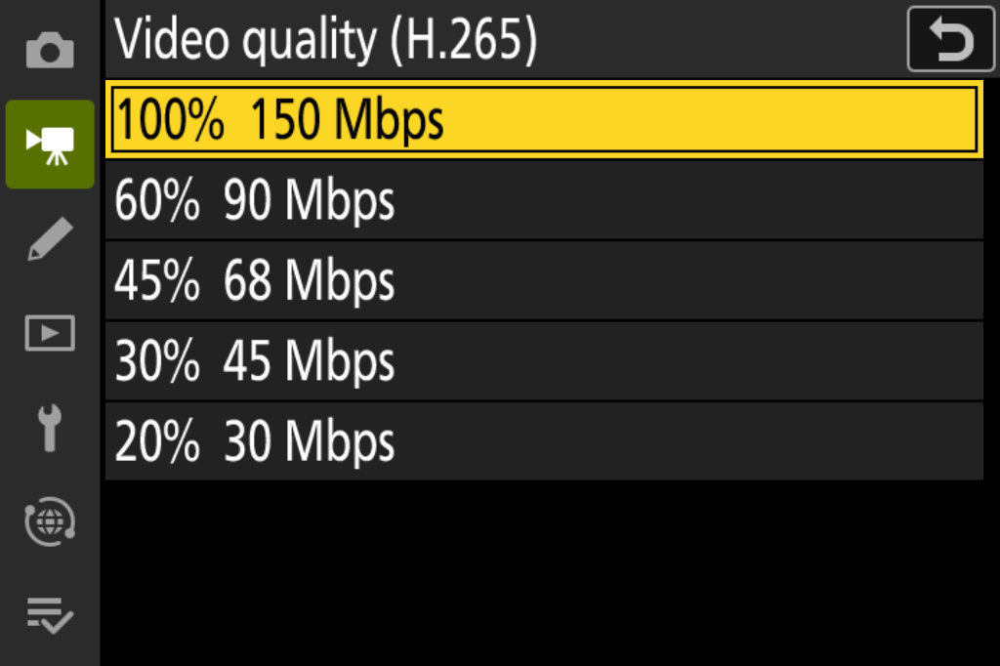
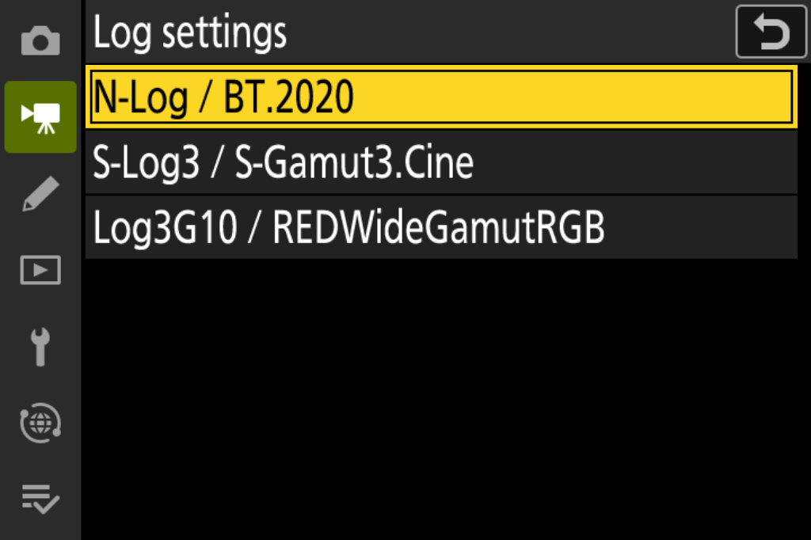
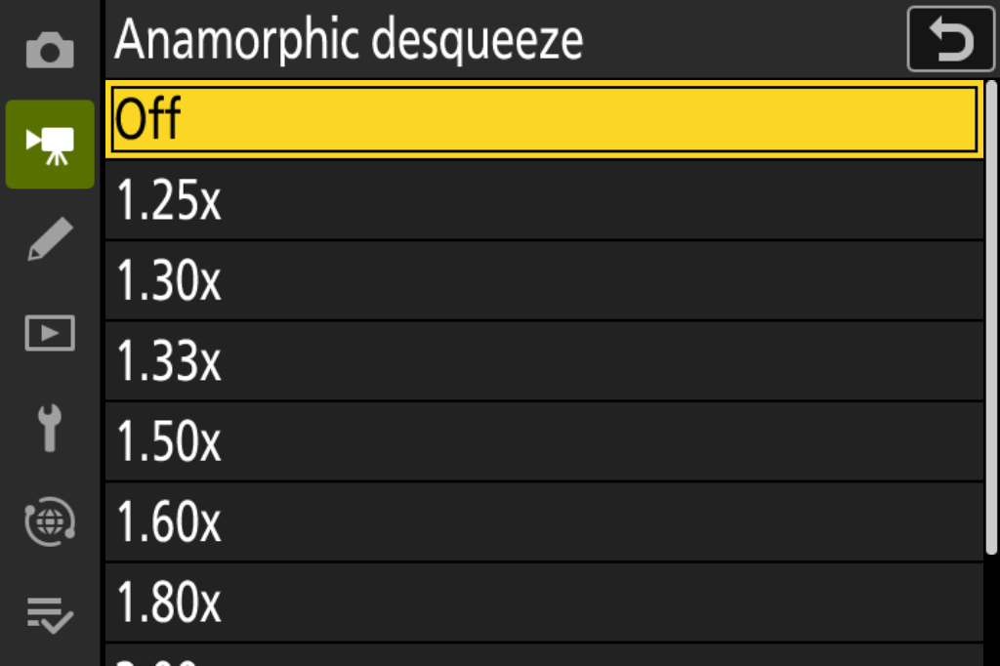
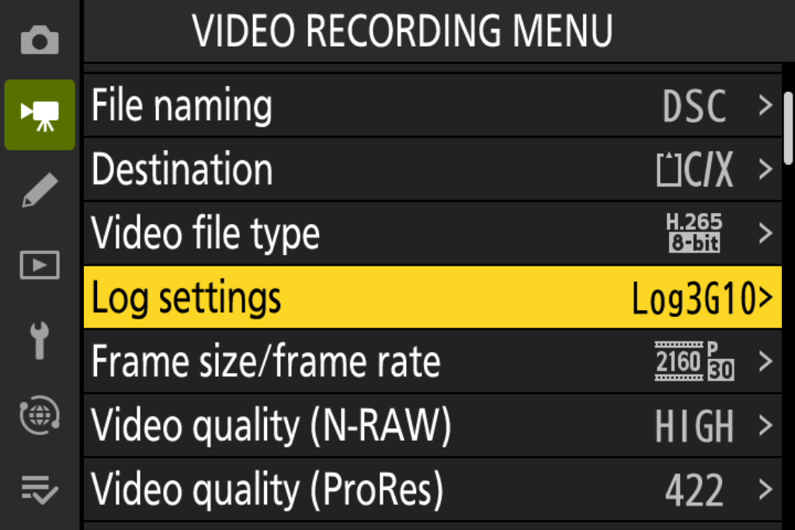

# NikonFirmwarePatch — Nikon Z8 功能扩展

[简体中文](#简体中文) · [English](#english) · [功能预览 / Preview](#功能预览--feature-preview) · [Changelog](CHANGELOG.md)

## 功能预览 / Feature preview

英文模拟器菜单，点击可查看原图。Select a panel to view the original emulator screenshot.

| **ProRes 画质 / ProRes quality** | **H.265 码率 / H.265 bitrate** |
|---|---|
| <a href="docs/images/prores-quality-options.png"></a> | <a href="docs/images/h265-bitrate.png"></a> |
| **开放门帧率 / Open-gate frame rates** | **N-RAW 四档 / N-RAW quality tiers** |
| <a href="docs/images/opengate-frame-rates.png"></a> | <a href="docs/images/nraw-quality-tiers.png"></a> |
| **Log 与色域 / Log and gamut** | **反挤压倍率 / Desqueeze factor** |
| <a href="docs/images/log-settings.png"></a> | <a href="docs/images/desqueeze-options.png"></a> |
| **像素位移合成 / Pixel-shift merge** | **视频菜单取值 / Saved video settings** |
| <a href="docs/images/pixelshift-groups.png"></a> | <a href="docs/images/video-menu-values.png"></a> |

## 简体中文

Nikon Z8 C 3.11 实验补丁的离线构建工具。提供四组可独立选择的功能，并可一次构建任意组合。本版为 **v0.4.0-rc.2 预发布版**。[下载完整工具包与校验清单](https://github.com/XinmiaoZhao/NikonFirmwarePatch/releases/tag/v0.4.0-rc.2)。使用本轮补丁构建的全选固件，已实机验证新录与旧录 N-RAW 的 Log 回放名称和辅助观感。

**使用风险。** 这是实验固件，构建或安装可能造成数据丢失、卡损坏或相机故障。离线检查不等于实机安全保证，请勿用于不可替代的工作。无担保及责任条款见 [LICENSE](LICENSE) 和 [NOTICE](NOTICE.md)。

| 构建选项 | 功能 |
|---|---|
| `framing` | FX 8.3K 30/25/24p N-RAW 开放门 3:2、反挤压预览／回放、N-RAW 四档品质 |
| `video-quality` | ProRes HQ／422／LT／Proxy 及 HQ 星标；H.265 五档码率、星标与保护计时修正 |
| `log-colour` | Log 菜单选择 N-Log／BT.2020、S-Log3／S-Gamut3.Cine、Log3G10／REDWideGamutRGB，含标签、图标和显示辅助 |
| `photo-tools` | C15/C30 RAW 预拍（FX/DX，无损选择回退 HE★）与像素偏移合成（修复任意起始编号的组识别） |

N-RAW 四档始终与开放门在同一组；`video-quality` 指 ProRes＋H.265。反挤压可关闭，开放门只在选择相应画幅时启用。照片组的两项功能各有机内入口。像素位移合成需要完整的 FX 无损 NEF 组，预拍输出不适用。Log 录像使用经实拍标定的矩阵与常量 Cpxs；S-Log3 沿用原厂截零，Log3G10 录像不含 RED 的 F 映射。

四组有 15 种非空组合。旧选项 `prores / precapture / pixelshift / opengate-nraw` 不再被当前 CLI 接受，也不会静默扩大为新组；需要复现旧包时使用对应旧发布源码与工具包。

### 获取固件与工具包

使用完整版 [toolkit ZIP](https://github.com/XinmiaoZhao/NikonFirmwarePatch/releases/download/v0.4.0-rc.2/NikonFirmwarePatch-v0.4.0-rc.2-toolkit.zip)，按 [SHA256SUMS.txt](https://github.com/XinmiaoZhao/NikonFirmwarePatch/releases/download/v0.4.0-rc.2/SHA256SUMS.txt) 核对下载后解压。GitHub 自动生成的 Source code 包和 Git 克隆只含源码；完整工具包还带九个经审阅的预编译补丁单元。工具源码、预编译单元及配方须来自同一版。

请自行从 Nikon 取得 [Z8 C 3.11 官方输入](https://download.nikonimglib.com/archive8/wP5Vr003qbpC07ibhJ666rmRfF47/Z_8_0311.bin) 并遵守其许可条款。尼康原 C 3.11 说明页已下线，可查阅[原说明页的 Wayback 快照](https://web.archive.org/web/20260920232234/https://downloadcenter.nikonimglib.com/en/download/fw/606.html)。固件由尼康服务器提供，另有[尼康备用下载链接](https://download.nikonimglib.com/archive8/ulkCY0035nUW07Elwhy66zV8P546/Z_8_0311.bin)。两个链接的完整文件核验记录见 [issue #11](https://github.com/XinmiaoZhao/NikonFirmwarePatch/issues/11#issuecomment-6493044598)。

### 构建与核验

输入必须是用户自行取得的**完整原厂 Z8 C 3.11** `Z_8_0311.bin`，99,051,117 字节，SHA-256：

```text
d67413c2ede6b9ce8887175f20700bd9fbad2a973a4820968c45503d15d80d96
```

不支持 C 3.12，不接受已经打补丁的固件。仓库不包含原厂固件、相机素材或运行库。工具只生成本地文件，不访问存储卡、不更新相机。

需要 Python 3.10+。从解压的工具包目录操作。macOS／Linux 建立虚拟环境：

```sh
python3 -m venv .venv
source .venv/bin/activate
```

Windows PowerShell 可用以下命令（示例选择 Python 3.12）：

```powershell
py -3.12 -m venv .venv
.\.venv\Scripts\Activate.ps1
```

激活后安装工具包固定的依赖：

```sh
python -m pip install -r requirements.txt
```

检查输入：

```sh
python patch.py Z_8_0311.bin --check
```

以下命令使用完整工具包的默认预编译模式。直接从 Git 源码构建时，在构建命令末尾加 `--code-source source --compiler clang`；已核对的编译器为 Apple clang 21.0.0（clang-2100.1.1.101）。其他编译器须产生相同字节、符号与入口地址。缺少或损坏预编译单元时工具会停止。

```sh
# 单独构建画幅组。
python patch.py Z_8_0311.bin --features framing --version 04.06 --tag p0 --output build/framing

# 全选四组，版本号用于标识本次输出。
python patch.py Z_8_0311.bin --features framing video-quality log-colour photo-tools --version 04.06 --tag p0 --output build/all
# v0.4.0-rc.2 四组全选、版本 04.06、tag p0：build/all/Z_8_0406.bin 的 SHA-256
# 4deca457f0e3af1ea858e53db55ce4946cd99d916c663304e351047c049d2a63

# 交互选择四组；预编译工具包默认不调用编译器。
python patch.py Z_8_0311.bin --interactive --version 04.06 --tag p0 --output build/chosen

# 在任意功能组合上叠加自定义快门声（WAV 要求与行为见 docs/custom-shutter-sound.md）。
python shutter_sound.py Z_8_0311.bin --features framing video-quality log-colour photo-tools --version 04.07 --tag w0 --output build/all-wav

# 仅快门声，不含四组功能。
python shutter_sound.py Z_8_0311.bin --shutter-sound-only --version 04.07 --tag w0 --output build/wav
```

快门声叠加建议使用 `w` 族标签；其 `--code-source` 只作用于快门声单元（默认预编译零槽单元，无需编译器；源码模式钉定 LLVM 19.1.7）。四组功能基底始终使用评审过的预编译单元。

构建输出为 `.bin`、`manifest.json` 和 `SHA256SUMS.txt`。输出目录必须不存在；输入原件不会被覆盖。本页各命令统一用 04.06 演示。不同功能组合可能使用相同文件名；保留各自的输出目录，按 manifest 中的功能清单和 SHA-256 区分。实际上机时建议给不同内容分配不同身份。`00.xx.t0` 仅用于离线测试，不能作为上机包。

独立核验示例：

```sh
python verify.py Z_8_0311.bin build/all/Z_8_0406.bin --features framing video-quality log-colour photo-tools --version 04.06 --tag p0
```

`verify.py` 不导入构建器，独立检查封装、输入身份、补丁窗口和未改字节，并检查共享菜单、分组可见性、字符串边界与初始化状态。它不能证明相机上的硬件行为。

版本格式为 `NN.NN`，内部 tag 为一个小写字母加一位数字。Z8 支持降级或同版本重刷；恢复时使用此前能正常工作的完整固件包。工具不能读取当前机身版本。每次均从原厂输入选择功能，以新目录接收输出。

### 功能说明与验证

- [四组结构与迁移](docs/feature-groups.md)
- [开放门／N-RAW](docs/opengate-nraw.md)、[反挤压](docs/anamorphic.md)
- [ProRes](docs/prores.md)、[H.265](docs/h265.md)
- [Log 设置与后期流程](docs/log-colour.md)、[色彩报告：中文](docs/log-colour-report.md)／[English](docs/log-colour-report.en.md)、[后期 F LUT](luts/README.md)
- [RAW 预拍](docs/raw-precapture.md)、[像素偏移](docs/pixelshift.md)
- [当前验证](docs/validation.md)、[已知问题](docs/known-issues.md)、[更新日志](CHANGELOG.md)

[发布包内容和验证流程](docs/releases.md)列出维护者回归命令；构建组合回归可运行 `python tests/validate_combinations.py --stock /path/to/Z_8_0311.bin --report build/combinations.json`，需要审阅过的源码编译器。

若发现 `Z8PRESTP.BIN` 或预期 RAW 却只写出 JPEG，请停止连拍、等待写入结束，并保留两张卡上的文件。即使空的同名停止文件也会生效。见[停止文件指南](docs/stop-file.md)。

### 色彩测试与后期 LUT

[中文版色彩报告](docs/log-colour-report.md)与[英文版](docs/log-colour-report.en.md)分别展示当前录像与同场 N-RAW 的实拍色差，以及简化矩阵、原厂色相表和恒等 Cpxs 的模拟偏色。当前后期操作见 [Log 设置与 Resolve／FCP 流程](docs/log-colour.md)：明确指定输入色域与曲线，检查自动识别，并避免重复转换。

[65³ 后期 F LUT](luts/README.md)以 RWG／Log3G10 输入和输出，给当前无 F 素材近似补上 RED 解码 N-RAW 时引入的饱和度映射，再接显示变换。LUT、生成脚本和独立数值核验随仓库提供。

源码和自编译补丁采用 GPL-3.0-only。Nikon 固件适用其原有许可。本项目与 Nikon 无隶属关系。见 [LICENSE](LICENSE)、[NOTICE](NOTICE.md)。

## English

This offline toolkit builds experimental patches for the original Nikon Z8 C 3.11 firmware. Select any of four feature groups or combine them in one build. The current pre-release is **v0.4.0-rc.2**. [Download the toolkit and checksums](https://github.com/XinmiaoZhao/NikonFirmwarePatch/releases/tag/v0.4.0-rc.2). On a Z8, the all-feature firmware built with this update showed the expected Log names and assist rendering when playing both newly recorded and existing N-RAW clips.

**Risk of use.** Building or installing experimental firmware can cause data loss, card corruption or camera malfunction. Offline checks cannot guarantee safe operation on a camera. Avoid using experimental firmware for irreplaceable work. See the warranty and liability terms in [LICENSE](LICENSE) and [NOTICE](NOTICE.md).

| Build group | Included features |
|---|---|
| `framing` | FX 8.3K 30/25/24p N-RAW 3:2 open gate, anamorphic desqueeze in preview and playback, and four N-RAW quality tiers |
| `video-quality` | ProRes HQ/422/LT/Proxy with an HQ star, plus five H.265 bitrate settings, star indication and a protection-timer fix |
| `log-colour` | N-Log / BT.2020, S-Log3 / S-Gamut3.Cine or Log3G10 / REDWideGamutRGB, with labels, icons and view assist |
| `photo-tools` | C15/C30 RAW pre-capture in FX/DX with lossless selection falling back to HE★, and pixel-shift merging with any starting file number |

The four N-RAW tiers belong to the open-gate group. ProRes and H.265 belong to `video-quality`. Desqueeze can be disabled, and open gate applies only when the corresponding frame size is selected. The two photo tools have separate camera controls. Pixel-shift merging requires a complete group of lossless FX NEFs, which excludes pre-capture outputs. Log recording uses camera-calibrated matrices and constant chroma compensation (Cpxs). S-Log3 retains stock clipping at zero; Log3G10 recording omits RED’s F mapping.

There are 15 nonempty combinations. The current CLI rejects the legacy names `prores / precapture / pixelshift / opengate-nraw` to avoid silently expanding a selection. To reproduce an earlier package, use that release’s source and toolkit.

### Get the firmware and toolkit

Download the complete [toolkit ZIP](https://github.com/XinmiaoZhao/NikonFirmwarePatch/releases/download/v0.4.0-rc.2/NikonFirmwarePatch-v0.4.0-rc.2-toolkit.zip), check it against [SHA256SUMS.txt](https://github.com/XinmiaoZhao/NikonFirmwarePatch/releases/download/v0.4.0-rc.2/SHA256SUMS.txt), then extract it. Git clones and GitHub’s automatic source archives contain the source only. The complete toolkit includes nine reviewed precompiled patch units. Use tools, patch units and recipes from the same release.

Obtain the [original Z8 C 3.11 firmware](https://download.nikonimglib.com/archive8/wP5Vr003qbpC07ibhJ666rmRfF47/Z_8_0311.bin) from Nikon under its license terms. Nikon has withdrawn the original C 3.11 landing page. The [Wayback snapshot of the original instructions](https://web.archive.org/web/20260920232234/https://downloadcenter.nikonimglib.com/en/download/fw/606.html) preserves that page. The firmware download is served by Nikon, with an [alternate Nikon download](https://download.nikonimglib.com/archive8/ulkCY0035nUW07Elwhy66zV8P546/Z_8_0311.bin). Both downloads were verified in full in [issue #11](https://github.com/XinmiaoZhao/NikonFirmwarePatch/issues/11#issuecomment-6493044598).

### Build and verify

Use the complete, original Z8 C 3.11 file `Z_8_0311.bin` (99,051,117 bytes). Its SHA-256 is

```text
d67413c2ede6b9ce8887175f20700bd9fbad2a973a4820968c45503d15d80d96
```

C 3.12 and previously patched inputs are unsupported. The repository excludes original firmware, camera media and runtimes. The tool generates local files only and does not access memory cards or update the camera.

Use Python 3.10+ and work in the extracted toolkit directory. On macOS or Linux, create a virtual environment with

```sh
python3 -m venv .venv
source .venv/bin/activate
```

In Windows PowerShell, the following example selects Python 3.12.

```powershell
py -3.12 -m venv .venv
.\.venv\Scripts\Activate.ps1
```

Activate the environment, then install the pinned dependency.

```sh
python -m pip install -r requirements.txt
```

Check the input firmware.

```sh
python patch.py Z_8_0311.bin --check
```

The commands below use the complete toolkit’s default prebuilt mode. When building directly from Git source, append `--code-source source --compiler clang` to the build command. The reviewed compiler is Apple clang 21.0.0 (clang-2100.1.1.101). Any other compiler must reproduce the pinned bytes, symbols and entry addresses. Missing or damaged prebuilt units stop the build.

```sh
# Build only the framing group.
python patch.py Z_8_0311.bin --features framing --version 04.06 --tag p0 --output build/framing

# Build all four groups; the version identifies the output.
python patch.py Z_8_0311.bin --features framing video-quality log-colour photo-tools --version 04.06 --tag p0 --output build/all
# SHA-256 of build/all/Z_8_0406.bin with v0.4.0-rc.2, all four groups, version 04.06 and tag p0
# 4deca457f0e3af1ea858e53db55ce4946cd99d916c663304e351047c049d2a63

# Choose groups interactively; prebuilt mode runs without a compiler.
python patch.py Z_8_0311.bin --interactive --version 04.06 --tag p0 --output build/chosen

# Stack the custom shutter sound on any feature combination (see docs/custom-shutter-sound.md).
python shutter_sound.py Z_8_0311.bin --features framing video-quality log-colour photo-tools --version 04.07 --tag w0 --output build/all-wav

# Custom shutter sound only, without the four feature groups.
python shutter_sound.py Z_8_0311.bin --shutter-sound-only --version 04.07 --tag w0 --output build/wav
```

Shutter-sound-inclusive builds use the `w` tag family. `--code-source` applies to the shutter-sound unit only (the reviewed prebuilt unit ships with the Release toolkit; git checkouts build it with `source`, byte-matching the pinned LLVM 19.1.7 recipe). The four-group base always uses the reviewed prebuilt units.

Each build produces a firmware `.bin`, `manifest.json` and `SHA256SUMS.txt`. Choose an output directory that does not already exist. The original input is preserved. All examples use 04.06. Different selections can therefore produce the same filename. Keep their output directories separate and identify each package by the feature list and SHA-256 in its manifest. Assign distinct identities to different packages for camera use. Reserve `00.xx.t0` for offline testing.

Independently verify the full-selection example.

```sh
python verify.py Z_8_0311.bin build/all/Z_8_0406.bin --features framing video-quality log-colour photo-tools --version 04.06 --tag p0
```

`verify.py` checks the container, original input identity, patch windows and preserved bytes independently of the builder. It also checks shared menus, feature visibility, string boundaries and initial state. Hardware behaviour requires camera testing.

The version format is `NN.NN`; the internal tag is one lowercase letter followed by one digit. The Z8 supports downgrades and same-version reinstalls. For recovery, use a complete firmware package that previously worked on the camera. The toolkit cannot read the installed camera version. Always build from the original input into a new output directory.

### Feature guides and verification

- [Four feature groups and migration](docs/feature-groups.md)
- [Open gate / N-RAW](docs/opengate-nraw.md) and [desqueeze](docs/anamorphic.md)
- [ProRes](docs/prores.md) and [H.265](docs/h265.md)
- [Log settings and grading workflow](docs/log-colour.md#english), colour report in [Chinese](docs/log-colour-report.md) or [English](docs/log-colour-report.en.md), and [F LUT for post](luts/README.md)
- [RAW pre-capture](docs/raw-precapture.md) and [pixel shift](docs/pixelshift.md)
- [Current validation](docs/validation.md), [known limits](docs/known-issues.md) and [changelog](CHANGELOG.md)

[Release contents and verification](docs/releases.md) lists the maintainer checks. Run the combination regression with `python tests/validate_combinations.py --stock /path/to/Z_8_0311.bin --report build/combinations.json` using the reviewed source compiler.

If `Z8PRESTP.BIN` appears or a RAW selection unexpectedly produces only JPEG, stop the burst, wait for writes to finish and preserve the files on both cards. Even an empty stop file takes effect. Follow the [stop-file guide](docs/stop-file.md#english-summary).

### Colour tests and the post-production LUT

The [Chinese](docs/log-colour-report.md) and [English](docs/log-colour-report.en.md) reports compare recorded footage with same-scene N-RAW. They also simulate colour shifts with simplified matrices, the stock hue table and identity Cpxs. The [Resolve and Final Cut Pro guide](docs/log-colour.md#english) explains how to set the input gamut and curve, check automatic identification and avoid applying a conversion twice.

The [65³ F LUT](luts/README.md) takes RWG / Log3G10 input and produces RWG / Log3G10 output. It approximates the saturation mapping introduced by RED’s N-RAW decode for footage recorded without F. Apply the display transform after this step. The repository includes the LUT, generator and independent numerical checks.

Original source and compiled patches use GPL-3.0-only. Nikon firmware retains its own licensing. This project is independent of Nikon. See [LICENSE](LICENSE) and [NOTICE](NOTICE.md).

## 致谢 / Acknowledgements

感谢以下贡献者，**排名不分先后**。Acknowledgements are in no particular order.

- [@Mei-MingLe（日月）](https://github.com/Mei-MingLe)：提供研究思路和分析。 Research ideas and analysis.
- [@heavensabove（pai）](https://github.com/heavensabove)：提供像素位移合成的基础代码和基础工作。 Foundational pixel-shift merge work and base code.
- [@y-g-jiang（Jiang Yaogeng）](https://github.com/y-g-jiang) 和“地上相机AAA”：提供研究思路、建议与技术讨论。 Research ideas, suggestions and technical discussions.
- [@YouKakou（时雨）](https://github.com/YouKakou)：开展 Log3G10 色彩的基础探索。 Foundational exploration of Log3G10 colour.
- [@ShiSheng233（锂化溴）](https://github.com/ShiSheng233)：提供开放门的思路、框架及相关参考实现。 Open-gate ideas, implementation framework and reference implementation.
- [@aoyukkk（傲宇）](https://github.com/aoyukkk)、[@South-Bridge（琴岛唯一指定哥布林）](https://github.com/South-Bridge)和“追晚霞的流浪汉”：协助开发、开展实机测试并反馈问题。 Development assistance, camera testing and feedback.
- [@PIPA12344（ZengXu）](https://github.com/PIPA12344)与 [s3lemming](https://github.com/s3lemming)：卡内 WAV 快门声的 Z9 原始实现、Z8 移植与 04.23 整合验证。 Z9 ancestor implementation, Z8 port and 04.23 integration of the card WAV shutter sound.

感谢 [RdWing/z8-qemu](https://github.com/RdWing/z8-qemu)、[WonderLantern/z9-qemu](https://github.com/WonderLantern/z9-qemu)、[WonderLantern/z7-qemu](https://github.com/WonderLantern/z7-qemu)与 [QEMU](https://www.qemu.org/) 的基础工作。We thank these emulator projects for the underlying models, tools and protocol references. See [NOTICE](NOTICE.md) for dependency credits and licensing.
