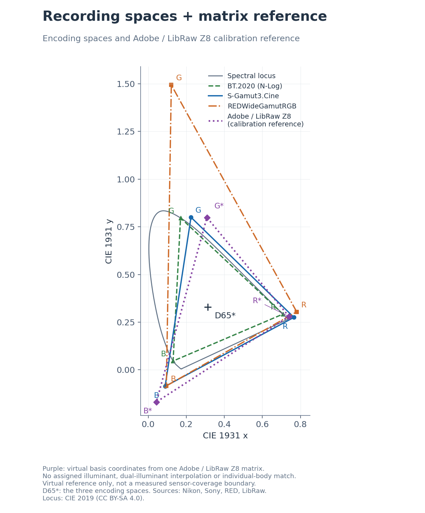
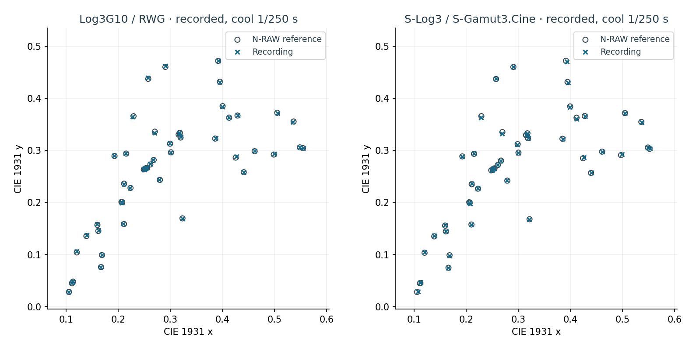
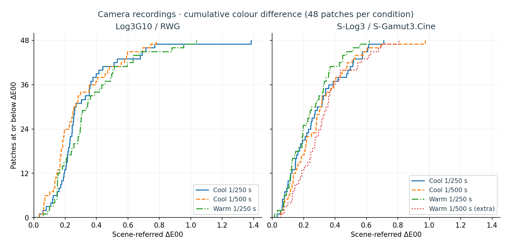
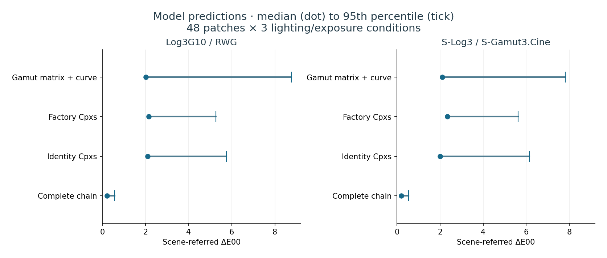
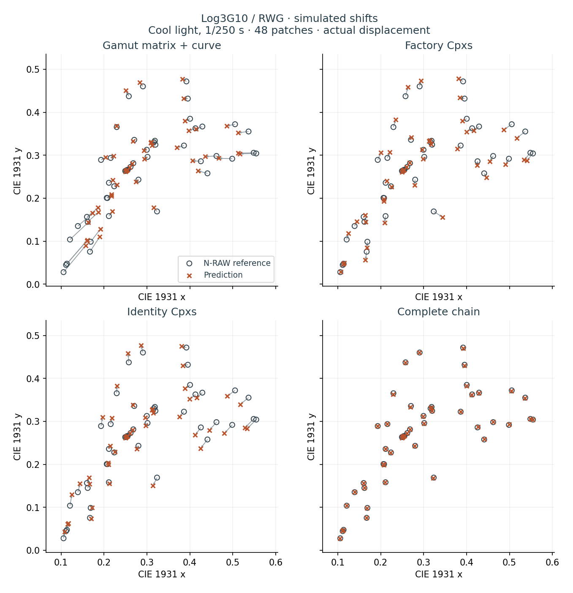
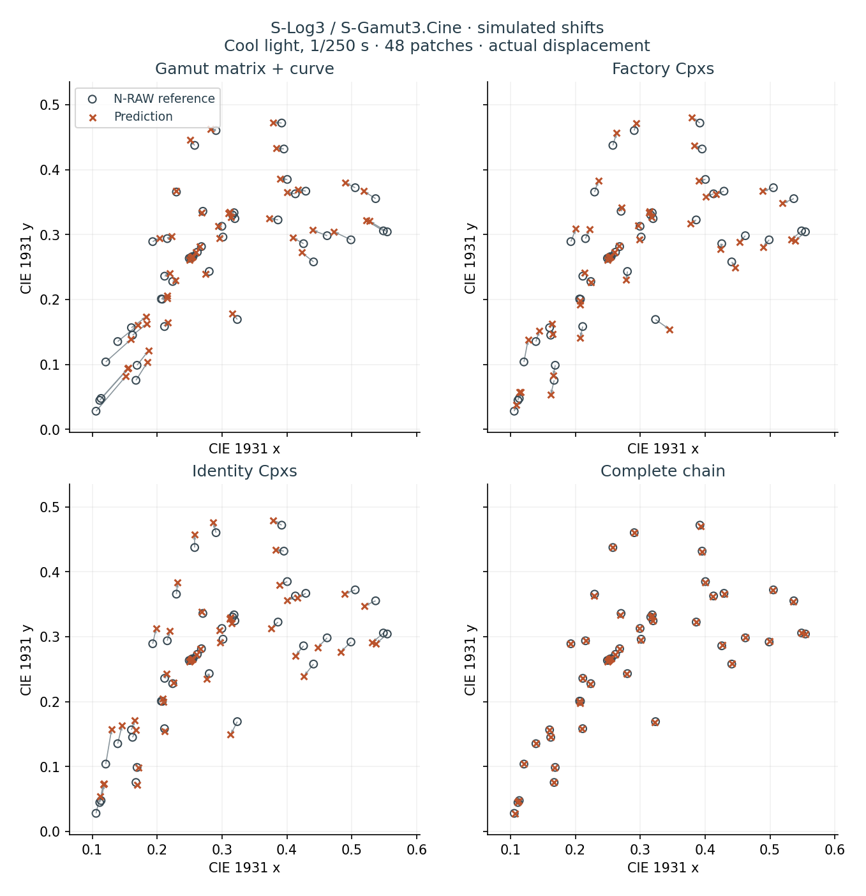

# Two in-camera Log outputs on the Nikon Z8

[中文](log-colour-report.md) · [Camera and post-production settings](log-colour.md#english) · [Data and reproduction](data/README.md)

The Nikon Z8 can record two wide-gamut Log outputs in H.265. Both use the camera’s processing chain to map sensor colours to the target gamut and encode the brightness range in a 10-bit file.

## Target gamuts and white point

The target spaces use the manufacturers' published primaries, D65 white point and transfer functions. In 10-bit S-Log3, black is 95 and 18% grey is 420. Log3G10 places 18% grey at approximately 1/3. See the [Sony technical summary](https://download.pro.sony/FNGP/protein/1237494271390/1237494271406.pdf) and [RED white paper](https://docs.red.com/955-0187/PDF/915-0187%20Rev-C%20%20%20RED%20OPS,%20White%20Paper%20on%20REDWideGamutRGB%20and%20Log3G10.pdf).



The blue, green and orange triangles show the three encoding spaces. The purple dotted triangle is a separate Adobe / LibRaw Z8 calibration-matrix reference. Some coordinates lie outside the visible spectral locus; these geometric ranges do not measure the colours a sensor can record.

The plot also includes **BT.2020 / N-Log**. Nikon's [N-Log Specification, section 3](https://download.nikonimglib.com/archive3/hDCmK00m9JDI03RPruD74xpoU905/N-Log_Specification_%28En%2901.pdf) explicitly identifies BT.2020 and D65 and gives the coordinates used here:

| Encoding space | Red (x, y) | Green (x, y) | Blue (x, y) |
|---|---|---|---|
| BT.2020 / N-Log | (0.708, 0.292) | (0.170, 0.797) | (0.131, 0.046) |
| S-Gamut3.Cine | (0.766, 0.275) | (0.225, 0.800) | (0.089, −0.087) |
| REDWideGamutRGB | (0.780308, 0.304253) | (0.121595, 1.493994) | (0.095612, −0.084589) |

The three encoding spaces use D65, (0.3127, 0.3290). The D65* marker refers only to those encoding spaces.

**Adobe / LibRaw Z8 calibration-matrix reference.** The [Nikon Z 8 entry in LibRaw](https://github.com/LibRaw/LibRaw/blob/2caab57e269cc7fce17c3189e4d4d7e3e5861875/src/tables/colordata.cpp#L1044-L1045) supplies the matrix below. The file attributes its matrices to Adobe DNG Converter unless otherwise noted. Its [use in LibRaw](https://github.com/LibRaw/LibRaw/blob/2caab57e269cc7fce17c3189e4d4d7e3e5861875/src/utils/utils_dcraw.cpp#L282-L312) establishes the direction as XYZ to reference camera native RGB:

```text
C = [11423, -4564, -1123;
     -4816, 12895,  2119;
      -210,  1061,  7282] / 10000
```

With `A = C⁻¹`, divide each column of A by its own `X+Y+Z`. The purple triangle then has basis coordinates R = **(0.739875, 0.279513)**, G = **(0.308620, 0.798878)**, and B = **(0.043204, −0.168837)**. The [reference data](data/adobe-z8-matrix.json) records the matrix, pinned source version and derived coordinates.

This reference uses one published matrix, without dual-illuminant interpolation, individual-camera calibration matching or added chromatic adaptation. The entry does not specify its calibration illuminant; no 4000 K condition is assigned here. These are virtual basis coordinates of the matrix model, including a negative y for blue. They are not a measured sensor gamut, and triangle area does not represent the range of physically recordable colours.

## From linear RGB to recorded codes

M1 maps linear-light values toward the target gamut. The RGB curve then encodes Log values. M2 maps this output into the internal luma/chroma coordinates where Cpxs operates. Y2r converts the result back to RGB and the final matrix E generates file YCbCr. NLG is a companion luminance table. The equivalent model is

```
file = E × Y2r × Cpxs(M2 × curve(M1 × x)) + (0,512,512)
E = M2_custom = [109,366,37; -59,-197,256; 256,-233,-23] / 512
M2_factory    = [118,439,-45; -59,-352,411; 245,-212,-33] / 512
Y2r = [1024,0,1436; 1024,-352,-731; 1024,1815,0] / 1024
```

### How M1 maps camera inputs to each target gamut

M1 is a 3×3 matrix operating in linear light. Stock N-Log starts with an identity M1 base and composes it with style, ISO gain and body colour calibration. The BT.2020 primaries specified for finished N-Log describe the decoded recording. Identifying the coordinates at the M1 input requires a same-scene measurement.

Calibration works backwards from recordings made with known settings. Inverting the downstream transforms and curve estimates the linear signal, and the known M1 gives an estimate of the common input. Paired N-RAW provides a linear RWG target after removing the decoder’s saturation mapping F. Log3G10 uses that target directly. For S-Log3 the reference is multiplied by `C_RWG→Cine = inv(M_Cine→XYZ) × M_RWG→XYZ`. The two RGB-to-XYZ matrices follow from the primaries and D65 white point above.

Each mode uses one fixed matrix. Log3G10 calibration uses patches under three lights at two exposures. S-Log3 uses patches away from the zero clamp in separate calibration recordings. Each output channel is estimated by weighted least squares, dividing its residual by the target channel value plus 0.01 so bright patches and weak channels both influence the fit. The measurements below use separate recordings.

**From fitted matrix to firmware base.** For the tested body and settings, let B = B_Q14 / 16384. The initial base is `round(1024 × M1_target × B⁻¹)`. The integer base is then passed through the original composition and `round(A_Q10 × B_Q14 / 16384)` checked against the desired Q10 coefficients. Divide the entries below by 1024. The right column is the computed result for this body calibration.

| Log | M1 base | Calibrated product |
|---|---|---|
| Log3G10 | [848,418,−224; −33,1256,−181; 47,156,839] | [825,408,−191; −7,1190,−141; 47,173,822] |
| S-Log3 | [1041,208,−213; −13,1237,−184; 42,−170,1164] | [1007,212,−183; 12,1172,−144; 35,−128,1129] |

### RGB curves and companion NLG table

The curves are sampled on the camera's existing **229 nonuniform nodes**, with identical values for all three channels. For node `x_i`, the current linear unit is `0.00045 × x_i`. With `E10` denoting the target curve's 10-bit code value:

```text
RGB15[i] = min(ceiling, floor(32 × E10(0.00045 × x_i) + 0.5))
NLG12[i] = (RGB15[i] + 4) // 8
```

RGB entries store 1/32 of a 10-bit code. The companion NLG table follows the same scale relationship. The S-Log3 storage ceiling is 32736, with an actual highest node of 31775. Current Log3G10 retains a top plateau at 24693, approximately 771.66 in 10-bit codes; this is a highlight limitation of the current implementation. The colour measurements below use unsaturated patches.

### Why M1 and M2 change together

M1 mixes linear-light signals. M2 mixes the encoded R′, G′ and B′ values coming out of the curve. In general, `curve(C × RGB) ≠ C × curve(RGB)`. Applying the same colour conversion on opposite sides of the curve gives different codes for saturated colours.

Consider M2 on its own using the integer matrices above. Setting `C_N = E⁻¹ × M2_factory` gives the factorization `M2_factory = E × C_N`. C_N maps neutral (420, 420, 420) to itself, but maps (420, 500, 600) to approximately (402.1, 477.0, 638.8). Greys can match while coloured patches experience appreciable mixing after the curve. This example isolates the difference between M2 and standard encoding. The simulation figures show the complete chain.

The patch maps camera inputs toward the target gamut with M1 in linear light, then uses BT.709 luma and colour-difference coefficients in M2. M2 produces internal coordinates, followed by Cpxs, Y2r and final encoding E. To interpret the recorded file, recover Log RGB with full-range levels and the BT.709 matrix, then apply colour management for RWG/Log3G10 or S-Gamut3.Cine/S-Log3.

For a ten-bit full-range file, the nominal BT.709 luma weights are 0.2126, 0.7152 and 0.0722 on R′, G′ and B′. Cb and Cr carry scaled differences B′−Y′ and R′−Y′, centred at code 512. E implements this conversion with coefficients in units of 1/512. Selecting a Log mode loads its M1 base, RGB/NLG curves, M2 and Cpxs together. Each body supplies its own calibration B.

## Why the complete chain needs Cpxs compensation

Let K = E × Y2r. Identity Cpxs carries K's channel mixing into the file. All 32 nodes use the same six Q8 coefficients [253, −28, −19, 252, 26, 50], approximating K⁻¹. The product K × Cpxs × M2 then approaches standard encoding E. BT.709 defines the file's YCbCr coding coefficients here. The linear gamut is RWG or S-Gamut3.Cine, respectively.

```
Yout = Y + (Pe × U + Pf × V)/256 = Y + (26U + 50V)/256
Uout = (Pa × U + Pb × V)/256 = (253U − 28V)/256
Vout = (Pc × U + Pd × V)/256 = (−19U + 252V)/256
```

The six stored fields are **Pa, Pb, Pc, Pd, Pe and Pf**. A Q8 value of 256 gives unit gain. Pa scales U and Pd scales V. Pb mixes V into U and Pc mixes U into V. Together with the diagonal gains, these cross terms set chroma direction and magnitude. Pe and Pf determine the contribution of chroma to luma Y. For example, increasing U by 16 internal units at fixed Y and V adds 1.625 to output Y, adds 15.8125 to output U and subtracts 1.1875 from output V.

The factory table interpolates between adjacent nodes on a ring indexed by internal U and V hue. An identity row is [256, 0, 0, 256, 0, 0]. The patch stores the same compensation row at all 32 nodes, giving the same coordinate transform at every hue.

## What the in-camera view assist renders

View assist affects live view and playback. After conversion to RGB, the display controller applies a 33-knot curve, a 3×3 matrix and a second 33-knot curve. Both modes target an SDR monitoring image with highlight roll-off.

- **S-Log3 / S-Gamut3.Cine** matches the neutral scale of the Z8's stock N-Log assist. The second curve is fitted at corresponding scene exposures on the two recording curves. The matrix starts from S-Gamut3.Cine to Rec.709 and carries over the correction in Nikon’s monitor matrix relative to a pure gamut transform. This preserves a familiar neutral rendering while interpreting colours in the selected gamut.
- **Log3G10 / REDWideGamutRGB** uses the matrix and second curve from mode 3 of the Nikon ZR 1.10 built-in view assist. The first curve matches the Z8's. This reproduces the ZR's simplified Log3G10 monitor transform. The ZR's selectable 3D LUT, RED IPP2 output presets and the optional F LUT used in post serve separate purposes.

Interpolating the firmware tables for display variant 0 gives normalized outputs of 44.9%, 44.8% and 45.2% for an 18% neutral in N-Log, S-Log3 and Log3G10. A 90% neutral gives 79.5%, 79.5% and 79.2%. These are modelled controller signals. Panel luminance, display gamma and colour-by-colour matching to a grading LUT require separate measurements. Recording-side M1 and chroma compensation are calibrated independently. With the all-feature firmware, the camera tester confirmed correct Log labels and assist appearance on both newly recorded and previously recorded N-RAW clips.

## Camera measurements against same-scene N-RAW

How closely does a Z8's H.265 recording match N-RAW from the same camera and scene when both are expressed in the same colour space? After exposure and white-balance alignment on three neutral patches, the **median scene-referred ΔE00** across 48 patches was **0.21–0.30 for Log3G10 / REDWideGamutRGB** and **0.20–0.28 for S-Log3 / S-Gamut3.Cine** in the three main conditions under cool and warm light.

Recordings used UHD 3840×2160, 29.97p, 10-bit 4:2:0 H.265, ISO 4000, 4000 K white balance and F4. Each condition uses two clips. Native Y/Cb/Cr patch means come from frames 60–89 in 48 fixed regions. N-RAW captures bracket each recording sequence. REDline 65.2.1 decodes the raw frames to linear RWG. Inverting its saturation mapping F gives the reference. For S-Log3, that linear reference is converted to S-Gamut3.Cine.

Both modes use the same convention. Each clip’s mean patch YCbCr codes are decoded to target linear RGB, then the two clips receive equal weight. The primary reference is the equal-weight linear mean of the bracketing N-RAW captures. This combines both recordings and references in coordinates proportional to light. Each table cell gives median and 95th-percentile ΔE00 over 48 patches. Lab uses D65 and the brightest patch’s Y in that group’s primary reference as white luminance.

| Condition | Log3G10 · median / P95 | S-Log3 · median / P95 |
|---|---:|---:|
| Cool 1/250 s | 0.24 / 0.71 | 0.24 / 0.59 |
| Cool 1/500 s | 0.21 / 0.66 | 0.28 / 0.59 |
| Warm 1/250 s | 0.30 / 0.81 | 0.20 / 0.50 |
| Warm 1/500 s (additional) | — | 0.30 / 0.66 |



Open circles mark the raw references and crosses mark the recordings. Both panels use identical xy axes and actual displacement lengths. ΔE00 also captures lightness differences that are absent from xy.



Each curve represents one lighting and exposure condition. At any ΔE00 on the horizontal axis, the height gives the number of patches at or below that difference. A count of 24 is half the sample. The value at 48 is the largest difference in that condition.

**Near black, channel ratios are sensitive to a weak channel.** Across the three main conditions, RMS error in neutral-aligned log₂(R/G) and log₂(B/G) was **0.010–0.012 stops for Log3G10** and **0.009–0.023 stops for S-Log3**. Luminance RMS was **0.006–0.009** and **0.008–0.009 stops**, respectively. Log3G10 includes all 48 patches. S-Log3 ratios use the 44–48 patches with camera and reference linear channels all ≥0.01. Under cool light at 1/250 s one dark patch had a linear red value of about 0.017. Its largest ratio error was **0.2002 stops** against the primary reference and **0.2080 stops against the earlier reference and 0.1925 against the later one**. Encoding individual reference blocks before averaging gave a Cr difference of **+0.68 ten-bit codes** against the earlier reference. These two readings describe different aspects of the same low signal.

In file-code space, the combined Y/Cb/Cr RMS across 45 S-Log3 patches was 0.52–0.77 ten-bit codes in the three main conditions. This measurement compares unaligned codes with the mean of the two encoded reference targets. It excludes the three dark-blue patches reported separately in the numerical data.

Eight additional samples were excluded from fitting. Their largest colour-ratio errors across the three main conditions were 0.025 stops for Log3G10 and 0.031 for S-Log3. Camera coverage is limited to the lights, body, exposures and encoding settings tested here.

## Simulation: where does colour move if only the gamut matrix and curve change?

A simulation explains why the patch changes both colour matrices and chroma compensation alongside the curve. On common inputs, changing only the linear gamut matrix and transfer curve moves deep blue substantially toward white.

One N-Log clip per condition supplies a common input for all four simulations. Each patch mean is traced back through the factory chain to estimate the signal before M1. That input is processed with each configuration below, keeping curve sampling, nonnegative clamping, Y2r and final BT.709 encoding common. Each prediction is compared with N-RAW from the same scene, aligning channels using only three neutral patches. The model works on ROI means. Near black, noise, curve encoding and spatial averaging interact.

| Model | M1 and curve | M2 | Cpxs |
|---|---|---|---|
| Gamut matrix + curve only | BT.2020-to-target matrix composed with body calibration, plus target Log curve | Factory | Factory hue table |
| Factory Cpxs | Calibrated target M1 and target Log curve | Current | Factory hue table |
| Identity Cpxs | Same | Current | Pass Y, U and V through |
| Complete chain | Same | Current | Fixed coordinate compensation at all 32 nodes |

The first Log3G10 row uses the verified parameters of the early RWG implementation. Its S-Log3 counterpart is a constructed BT.2020-to-S-Gamut3.Cine model using the same design principle. The last three rows isolate the effect of Cpxs. The first row shows the combined effects of the simplified M1, factory M2 and factory Cpxs.



Pooling 3 conditions × 48 patches per mode, changing only the gamut matrix and curve gives a predicted 95th-percentile ΔE00 of **8.77 for Log3G10 and 7.80 for S-Log3**. With the calibrated M1 and current M2, retaining factory Cpxs gives **5.27 and 5.63**. Identity Cpxs gives **5.76 and 6.14**. The complete coordinate compensation gives **0.57 and 0.53**. All these values are model predictions on common inputs.





A deep-blue patch under cool light at 1/250 s illustrates the direction. Its reference xy is (0.106, 0.028). The simple model predicts (0.157, 0.090) in Log3G10 and (0.152, 0.082) in S-Log3. Both move toward white, diluting the blue, with ΔE00 of 11.18 and 9.99. As an independent check, the complete Log3G10 model reproduces the corresponding recorded Y/Cb/Cr means to 0.18–0.41 codes RMS per component across the three conditions. The S-Log3 simulation uses the same N-Log inputs. Its camera measurements come from a separate capture sequence.

## Matching RED decode saturation in post

**In the reference path used here, REDline 65.2.1 introduces F when decoding Nikon N-RAW.** F is additional three-channel nonlinear colour processing in the RED decoding path, separate from the RWG gamut definition and the Log3G10 transfer function. Applying only an RWG matrix and Log3G10 curve therefore does not reproduce that decoded result. The report removes F from the reference to assess the current in-camera implementation against a no-F linear target.

F compresses highly saturated colours according to the ratio of the smallest to the largest linear-RGB channel, with a broader effect for blue-dominant colours. It preserves the largest channel and linear-RGB HSV hue, but may change XYZ luminance. The current in-camera Log3G10 implementation leaves this step to post-production.

The repository provides a **[65³ F-model LUT](../luts/RWG_Log3G10_F_v1_65.cube)** to approximate this part of RED's N-RAW decoding colour treatment on no-F footage. Both input and output are RWG / Log3G10. Recommended order:

**Correct source decoding → white-balance/exposure adjustment → F LUT → RWG/Log3G10 display or output transform.**

The F LUT does not convert the image to Rec.709. If the application automatically works in another colour space, arrange appropriate conversions before and after the node. N-RAW already decoded through the RED path described above contains F and should not receive it again. See the [LUT guide](../luts/README.md) for file identity, workflow and rebuilding commands.

The LUT uses 65×65×65 samples; tetrahedral interpolation is recommended. Across the 288 reference-patch inputs used for independent LUT validation, the difference from the analytic model is **0.040 of a 10-bit code RMS**, with a maximum **0.372 codes**. Dominant-channel changes introduce branch boundaries, and the model uses one scale-invariant treatment near black. Full grid and boundary stress-test results are in the [verification record](../luts/verification.json). This is the project's approximation of F for post-production, not a replacement for RED's complete decoding pipeline.

Parameters, measured patch means, simulated outputs and reproduction commands are in the [data guide](data/README.md).
