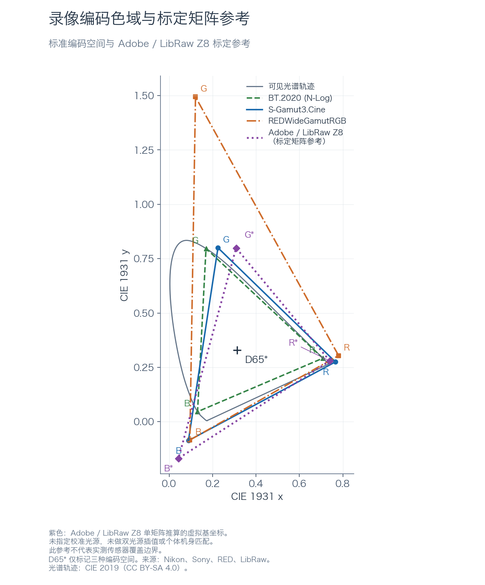
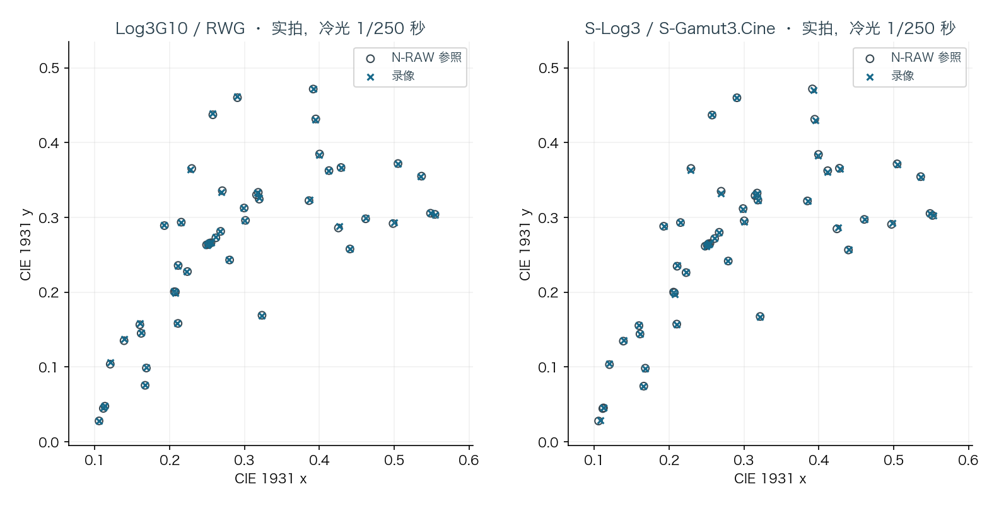
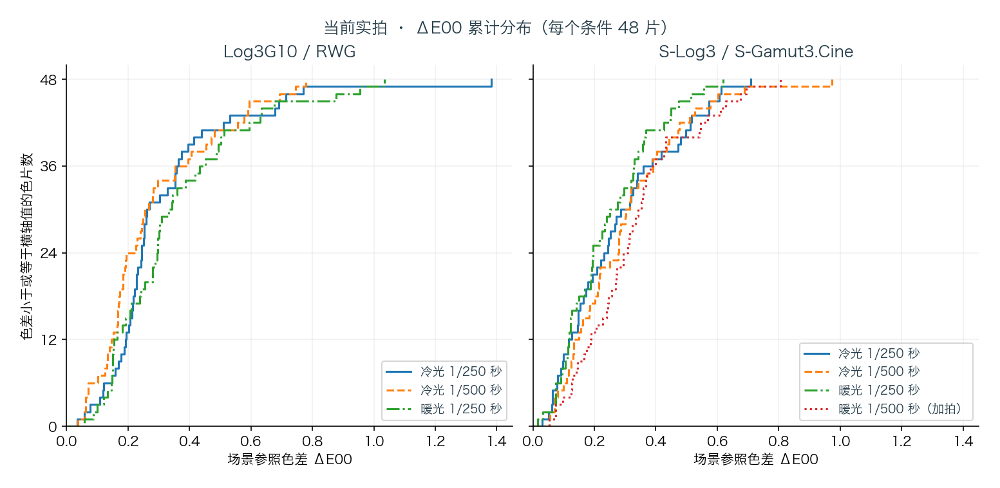
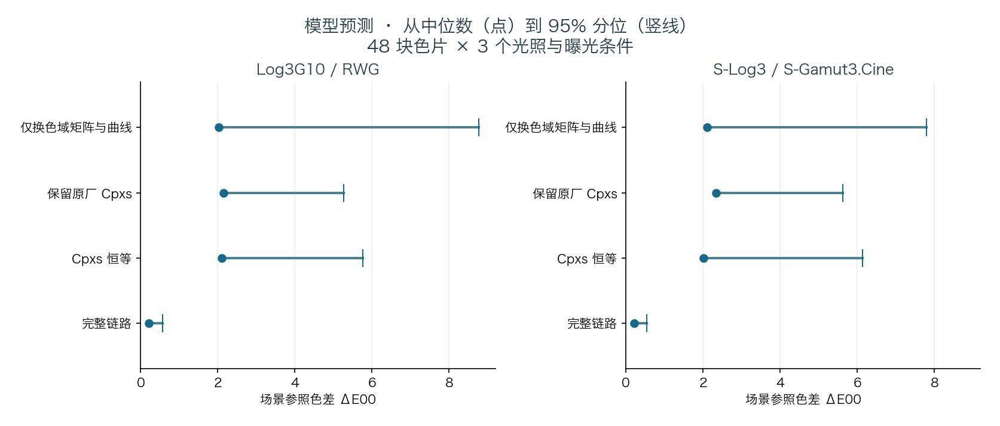
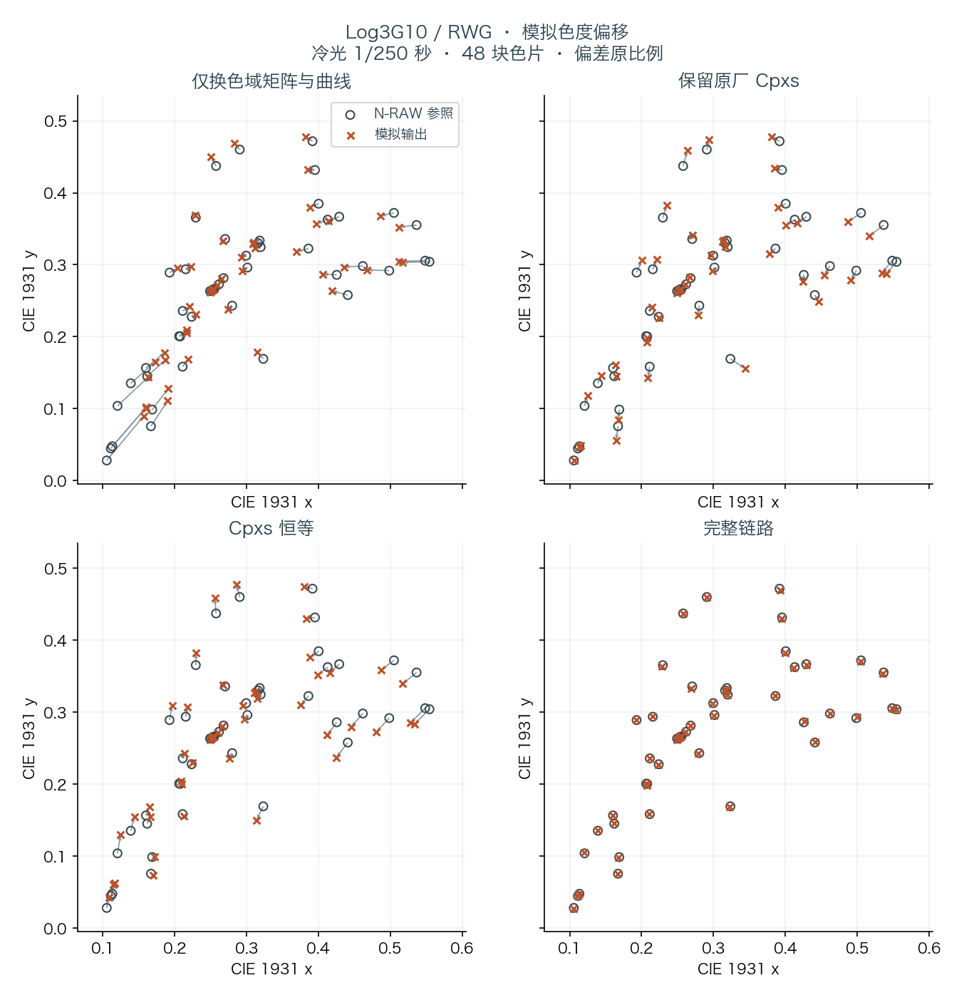
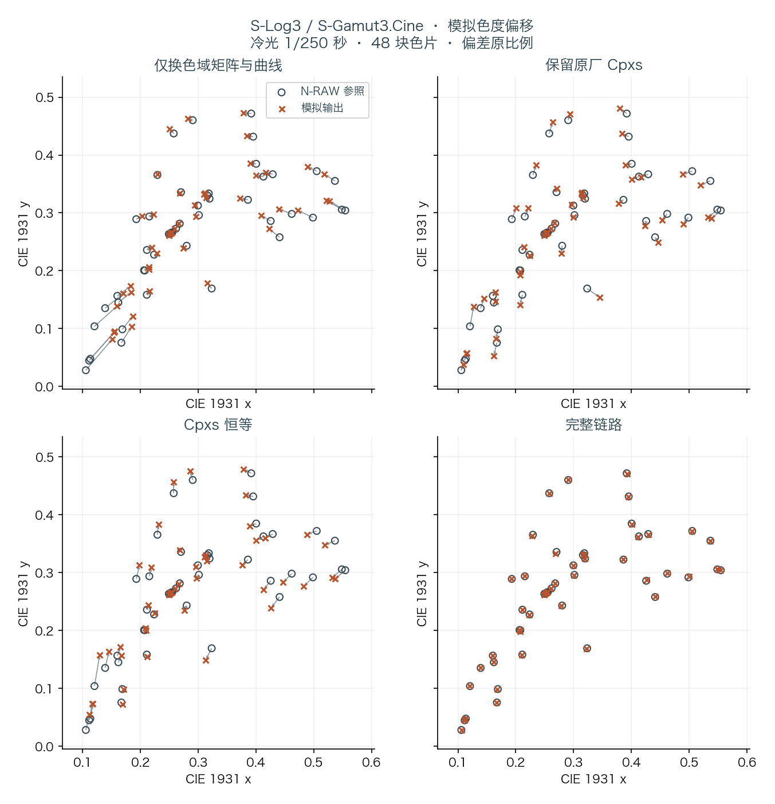

# Nikon Z8 的两种机内 Log 输出

[English](log-colour-report.en.md) · [机内与后期设置](log-colour.md) · [数值与复现](data/README.md)

Nikon Z8 的机内 H.265 可以记录两种宽色域 Log 输出。两者从同一条相机处理链出发，分别把传感器颜色映射到目标色域，再把亮度范围编码进 10-bit 文件。

## 目标色域与白点

目标空间采用厂商公布的原色、D65 白点和曲线公式。S-Log3 的 10-bit 黑电平为 95，18% 灰为 420；Log3G10 把 18% 灰编码到约 1/3。定义见 [Sony 技术说明](https://download.pro.sony/FNGP/protein/1237494271390/1237494271406.pdf)和 [RED 白皮书](https://docs.red.com/955-0187/PDF/915-0187%20Rev-C%20%20%20RED%20OPS,%20White%20Paper%20on%20REDWideGamutRGB%20and%20Log3G10.pdf)。



蓝、绿、橙三角形表示三种编码色彩空间，紫色虚线另列 Adobe／LibRaw Z8 的标定矩阵参考。部分坐标位于可见光谱轨迹之外；这些几何范围不代表传感器能记录其中的所有颜色。

图中同时加入 **BT.2020 / N-Log**。Nikon 的 [N-Log 规格文档第 3 节](https://download.nikonimglib.com/archive3/hDCmK00m9JDI03RPruD74xpoU905/N-Log_Specification_%28En%2901.pdf)明确给出了 BT.2020 色域、D65 白点及以下原色坐标：

| 编码色域 | 红原色 (x, y) | 绿原色 (x, y) | 蓝原色 (x, y) |
|---|---|---|---|
| BT.2020 / N-Log | (0.708, 0.292) | (0.170, 0.797) | (0.131, 0.046) |
| S-Gamut3.Cine | (0.766, 0.275) | (0.225, 0.800) | (0.089, −0.087) |
| REDWideGamutRGB | (0.780308, 0.304253) | (0.121595, 1.493994) | (0.095612, −0.084589) |

三种编码空间的白点均为 D65，坐标 (0.3127, 0.3290)；图中的 D65* 标记只对应这三种编码空间。

**Adobe／LibRaw Z8 标定矩阵参考。** [LibRaw 的 Nikon Z 8 条目](https://github.com/LibRaw/LibRaw/blob/2caab57e269cc7fce17c3189e4d4d7e3e5861875/src/tables/colordata.cpp#L1044-L1045)列出以下矩阵，文件说明其矩阵来自 Adobe DNG Converter（另有注明者除外）。根据 [LibRaw 的实际使用方向](https://github.com/LibRaw/LibRaw/blob/2caab57e269cc7fce17c3189e4d4d7e3e5861875/src/utils/utils_dcraw.cpp#L282-L312)，它将 XYZ 映射到参考相机原生 RGB：

```text
C = [11423, -4564, -1123;
     -4816, 12895,  2119;
      -210,  1061,  7282] / 10000
```

取 `A = C⁻¹`，将 A 的三列分别除以各自的 `X+Y+Z`，得到图中紫色三角形的基坐标：R = **(0.739875, 0.279513)**，G = **(0.308620, 0.798878)**，B = **(0.043204, −0.168837)**。矩阵、固定源码版本与推算坐标保存在[参考数据](data/adobe-z8-matrix.json)中。

这项参考只使用公开表中的一个矩阵，没有做双光源插值、个体机身校准匹配或附加色适应变换；该条目未给出校准光源信息，本文不将它标为 4000 K。它描述矩阵模型的虚拟基坐标，蓝基坐标的 y 为负，不是实测传感器色域，也不能用三角形面积代表真实可记录色域。

## 从线性 RGB 到录像码值

M1 在线性光域将信号映射到目标色域，RGB 曲线随后进行 Log 编码。M2 把曲线输出送入相机内部亮度与色度坐标，Cpxs 在这些坐标上工作。Y2r 将结果转回 RGB，末端矩阵 E 才生成文件中的 YCbCr。NLG 是与 RGB 曲线配套的亮度表。等效模型写成

```
file = E × Y2r × Cpxs(M2 × curve(M1 × x)) + (0,512,512)
E = M2_custom = [109,366,37; -59,-197,256; 256,-233,-23] / 512
M2_factory    = [118,439,-45; -59,-352,411; 245,-212,-33] / 512
Y2r = [1024,0,1436; 1024,-352,-731; 1024,1815,0] / 1024
```

### M1 如何得到两种目标色域

M1 是作用在线性光上的 3×3 矩阵。原厂 N-Log 的 M1 基表是单位阵，生成时还会合成样式、ISO 增益和机身色彩标定。因此，成品 N-Log 的 BT.2020 原色定义适用于解码后的录像；要确定 M1 入口的颜色坐标，还需要同场测量。

标定时，先从已知设置的录像码值反推曲线前的线性信号，利用已知 M1 估计共同输入；目标取配对 N-RAW 解码并撤销饱和度映射 F 后的线性 RWG。Log3G10 直接使用这个目标。S-Log3 的参照再乘 `C_RWG→Cine = inv(M_Cine→XYZ) × M_RWG→XYZ`。这里的两个 RGB→XYZ 矩阵由上面的原色和 D65 白点算出。

每种模式只估计一套固定矩阵。Log3G10 的标定使用三种光源、两档曝光的色片；S-Log3 使用独立标定组中远离截零的色片。从输入到目标的各输出通道分别做加权最小二乘，残差按 `目标通道值 + 0.01` 缩放，使亮片和弱通道都能影响拟合。下文实拍评价使用另一批录像。

**从拟合矩阵到固件基表。** 对本台机身和测试设置，设 B = B_Q14 / 16384，则基表初值取 `round(1024 × M1目标 × B⁻¹)`。把整数基表代回原生成路径，再核对 `round(A_Q10 × B_Q14 / 16384)` 是否得到目标 Q10 系数。下表各项均除以 1024，右列是按该机身标定算出的结果。

| Log | M1 基表 | 标定合成值 |
|---|---|---|
| Log3G10 | [848,418,−224; −33,1256,−181; 47,156,839] | [825,408,−191; −7,1190,−141; 47,173,822] |
| S-Log3 | [1041,208,−213; −13,1237,−184; 42,−170,1164] | [1007,212,−183; 12,1172,−144; 35,−128,1129] |

### RGB 曲线与配套 NLG 表

曲线沿相机原有的 **229 个非均匀节点**采样，三通道写入相同表值。设节点为 `x_i`，当前线性单位为 `0.00045 × x_i`，`E10` 为目标曲线的 10-bit 码值，则：

```text
RGB15[i] = min(上限, floor(32 × E10(0.00045 × x_i) + 0.5))
NLG12[i] = (RGB15[i] + 4) // 8
```

RGB 表以 1/32 个 10-bit 码值保存；NLG 配套表按同一关系生成，使两类表使用一致的编码标度。S-Log3 表的存储上限是 32736，实际最高节点为 31775。当前 Log3G10 表仍保留 24693 的顶部平台，约为 771.66 个 10-bit 码值；这属于当前实现的高光限制。下文色彩评价使用未饱和色片。

### 为什么 M1 和 M2 要配套修改

M1 混合的是线性光信号，M2 混合的是曲线输出的 R′、G′、B′。一般有 `curve(C × RGB) ≠ C × curve(RGB)`。把同一个颜色转换放在曲线两侧，饱和色会得到不同的码值。

用上文的整数矩阵单独看 M2。令 `C_N = E⁻¹ × M2_factory`，便可把原厂 M2 分解为 `E × C_N`。中性输入 (420, 420, 420) 经 C_N 仍为 (420, 420, 420)，彩色输入 (420, 500, 600) 则约为 (402.1, 477.0, 638.8)。灰阶可以对齐，彩色仍会经历明显的曲线后混色。这个例子只计算 M2 相对标准编码的差异，整条链的预测另见模拟图。

本方案让 M1 在线性域完成朝目标色域的映射，再让 M2 使用目标的 BT.709 亮度／色差系数。M2 产生的仍是机内坐标；后面还要经过 Cpxs、Y2r 和末端 E。读文件时先按全范围码值和 BT.709 矩阵还原 Log RGB，再按所选 RWG／Log3G10 或 S-Gamut3.Cine／S-Log3 做色彩管理。

10-bit 全范围文件中，BT.709 的名义亮度权重是 R′、G′、B′ 各占 0.2126、0.7152、0.0722。Cb 和 Cr 分别编码经过缩放的 B′−Y′、R′−Y′，中性码值为 512。E 用 1/512 为单位的整数系数实现这一步。机内选择 Log 时会成套装载 M1 基表、RGB／NLG 曲线、M2 和 Cpxs，生成 M1 时使用该台机身的标定 B。

## 为什么完整链路需要 Cpxs 补偿

令 K = E × Y2r。Cpxs 恒等会把 K 的混色带入文件。当前 32 个节点使用相同的六个 Q8 系数 [253, −28, −19, 252, 26, 50]，近似 K⁻¹。这样 K × Cpxs × M2 接近标准编码 E。BT.709 在这里规定文件 YCbCr 的编解码系数，录像的线性色域仍分别为 RWG 或 S-Gamut3.Cine。

```
Yout = Y + (Pe × U + Pf × V)/256 = Y + (26U + 50V)/256
Uout = (Pa × U + Pb × V)/256 = (253U − 28V)/256
Vout = (Pc × U + Pd × V)/256 = (−19U + 252V)/256
```

六个系数按 **Pa、Pb、Pc、Pd、Pe、Pf** 存储，Q8 中 256 表示增益 1。Pa 和 Pd 分别控制 U、V 自身的增益。Pb 把 V 混入 U，Pc 把 U 混入 V，两者连同对角增益决定色度方向和幅度。Pe、Pf 决定色度对亮度 Y 的贡献。例如，固定 Y，给输入增加 16 个单位的 U，V 固定，则输出的 Y 增加 1.625、U 增加 15.8125、V 减少 1.1875 个内部单位。

原厂表按内部 U、V 的色相位置在环上相邻节点间插值。恒等表每行是 [256, 0, 0, 256, 0, 0]。本方案把同一组补偿系数写入全部 32 个节点，因此每个色相位置得到同一个坐标变换。

## 机内显示辅助还原到什么观感

显示辅助只作用于取景和回放。显示控制器先将监看信号转为 RGB，再依次应用一条 33 节点曲线、一个 3×3 矩阵和第二条 33 节点曲线。两种 Log 的目标都是便于判断曝光与构图的 SDR 预览，保留亮部层次。

- **S-Log3 / S-Gamut3.Cine** 的灰阶以 Z8 原厂 N-Log 显示辅助为参照。按两套录像曲线上对应的场景亮度拟合第二条曲线；色彩矩阵从 S-Gamut3.Cine 到 Rec.709 的转换出发，沿用尼康监看矩阵相对标准色域转换的修正。因此同一场景的灰阶接近原厂监看，彩色仍依 S-Gamut3.Cine 解释。
- **Log3G10 / REDWideGamutRGB** 直接采用 Nikon ZR 1.10 内置显示辅助的模式 3 矩阵和第二条曲线；第一条曲线与 Z8 共用。目标是 ZR 的简化 Log3G10 监看。ZR 菜单可载入的三维 LUT、RED IPP2 的输出预设以及本文的后期 F LUT 各有独立用途。

按固件表分段插值，在显示变体 0 上，18% 中灰的归一化输出约为 N-Log 44.9%、S-Log3 44.8%、Log3G10 45.2%；90% 白分别为 79.5%、79.5%、79.2%。这些是显示控制器模型的码值。面板亮度、显示伽马或与某个后期输出 LUT 的逐色一致性需要另外测量。录像侧 M1、Cpxs 的标定与上述显示映射分开。全选固件已在机身回放新录及已有 N-RAW 片段，测试者确认类型和辅助观感随片段正确恢复。

## 实拍颜色与同场 N-RAW 的差距

在同一台 Z8 上，将机内 H.265 录像和同场 N-RAW 转到同一目标空间，可以直接比较同一块色片的颜色。本次测试覆盖冷光和暖光。按三块灰片对齐曝光与白平衡后，48 块色片的 **ΔE00 中位数**在三个主要条件下分别为 **0.21–0.30（Log3G10 / REDWideGamutRGB）** 和 **0.20–0.28（S-Log3 / S-Gamut3.Cine）**。这里衡量的是显示变换前的场景色差。

采用 UHD 3840×2160、29.97p、H.265 10-bit 4:2:0、ISO 4000、白平衡 4000 K、F4。各条件取两段录像的第 60–89 帧，以预先锁定的 48 个色片区域取原生 Y/Cb/Cr 均值。对应的 N-RAW 在录像前后拍摄，经 REDline 65.2.1 解码，再撤销解码时加入的饱和度映射 F，得到线性 RWG 参照。S-Log3 的参照再从 RWG 转到线性 S-Gamut3.Cine。

两种 Log 采用同一口径。每段先从色片的 YCbCr 均值解码到目标线性 RGB，再将两段等权平均。前后两份 N-RAW 也在线性域等权平均，作为主参照。这样重复录像和参照都在与光量成比例的坐标中合并。表中每格给出 48 片 ΔE00 的中位数与 95% 分位。Lab 白点取 D65，白亮度取该组主参照中最亮色片的 Y。

| 条件 | Log3G10 · 中位 / P95 | S-Log3 · 中位 / P95 |
|---|---:|---:|
| 冷光 1/250 秒 | 0.24 / 0.71 | 0.24 / 0.59 |
| 冷光 1/500 秒 | 0.21 / 0.66 | 0.28 / 0.59 |
| 暖光 1/250 秒 | 0.30 / 0.81 | 0.20 / 0.50 |
| 暖光 1/500 秒（加拍） | — | 0.30 / 0.66 |



空心圆是 N-RAW 参照，叉号是实拍。两幅图使用相同的 xy 坐标轴，连线长度就是实际色度位移。ΔE00 同时计入亮度，能补足 xy 图看不到的差别。



每条曲线对应一种光照和曝光条件。横轴取任一 ΔE00 值，纵轴给出色差小于或等于该值的色片数；24 片对应一半样本，48 片处可读出该条件的最大色差。

**近黑的比例误差对弱通道尤其敏感。** 用灰片对齐后的 log₂(R/G)、log₂(B/G) 衡量色彩比例，三个主要条件的 RMS 为 Log3G10 **0.010–0.012 档**、S-Log3 **0.009–0.023 档**。对应亮度 RMS 为 **0.006–0.009** 和 **0.008–0.009 档**。Log3G10 取全部 48 片。S-Log3 的比例统计只取录像和参照各线性通道均 ≥0.01 的 44–48 片。冷光 1/250 秒的一块深色片线性红值约 0.017，对主参照的最大比例误差为 **0.2002 档**，分别使用前、后参照为 **0.2080、0.1925 档**。若先逐块编码再取均值，这片对前参照的 Cr 差为 **+0.68 个 10-bit 码值**。比例指标与文件码值保留了同一近黑样本的两个观察角度。

在文件码值域，三个主要条件的 S-Log3 合计 Y/Cb/Cr RMS 为 **0.52–0.77 个 10-bit 码值**。此项直接比较录像码值与前后参照各自的线性 ROI 均值编码后再平均所得的码值，取固定的 45 片，其余三块深蓝片单列在数值文件中。

另有 8 块未用于拟合的色样。三个主要条件下，Log3G10 的最大色彩比例误差为 0.025 档，S-Log3 为 0.031 档。实拍结论的覆盖范围是这里的灯光、机身、曝光和编码设置。

## 模拟：只换矩阵和曲线，颜色会偏向哪里？

为什么要同时改矩阵、曲线和色度补偿？在相同输入上模拟只换线性色域矩阵和曲线，深蓝片会明显向白点移动。

三种拍摄条件各有一段 N-Log。将每块色片的录像均值沿原厂链反算，得到 M1 前的共同输入估计，再将这份输入分别送入下列四种链路。全部模型使用相同的曲线采样、截零、Y2r 与末端 BT.709 编码。对照目标是同一场景的 N-RAW。每组仅用三块灰片按通道对齐，彩色色片不参与对齐。模拟使用区域均值，近黑处曲线、噪声和空间平均的先后会影响结果。

| 模拟链路 | M1 与曲线 | M2 | Cpxs |
|---|---|---|---|
| 仅换色域矩阵与曲线 | BT.2020→目标色域矩阵与机身标定合成，换目标 Log 曲线 | 原厂 | 原厂色相表 |
| 保留原厂 Cpxs | 当前标定 M1 与目标 Log 曲线 | 当前 | 原厂色相表 |
| Cpxs 恒等 | 同上 | 当前 | 直接传递 Y、U、V |
| 完整链路 | 同上 | 当前 | 32 节点均作固定坐标补偿 |

第一行的 Log3G10 使用已核对的早期 RWG 实现参数。S-Log3 一栏是同原理构造的 BT.2020→S-Gamut3.Cine 模型。比较后三行可以单独观察 Cpxs 的影响。第一行同时改变了 M1、M2 与 Cpxs，展示整套简化做法的效果。



每种 Log 汇总 3 组 × 48 块色片。仅换色域矩阵与曲线，模拟 ΔE00 的 95% 分位在 Log3G10 为 **8.77**、S-Log3 为 **7.80**。换成当前 M1 和 M2 后，继续保留原厂 Cpxs，两者分别为 **5.27、5.63**。将 Cpxs 设为恒等，两者为 **5.76、6.14**。使用完整坐标补偿后分别为 **0.57、0.53**。这些都是同一组输入上的模型输出。





冷光 1/250 秒的深蓝片最能说明方向。参照 xy 为 (0.106, 0.028)，仅换矩阵与曲线时，Log3G10 预测为 (0.157, 0.090)，S-Log3 为 (0.152, 0.082)，都向白点移动，蓝色趋淡。对应 ΔE00 为 11.18 和 9.99。作为独立核对，将完整 Log3G10 模型的预测与同组实际录像比较，各组 Y/Cb/Cr 分量 RMS 为 0.18–0.41 码。S-Log3 的模拟使用相同 N-Log 输入，其实际录像来自单独的拍摄序列。

## 在后期匹配 RED 解码的饱和度

**本次参照使用的 REDline 65.2.1 在解码 Nikon N-RAW 时，会加入 F 处理。** F 是 RED 解码链中的额外三通道非线性色彩映射，与 RWG 色域定义、Log3G10 曲线分别属于不同环节。因此，仅写入 RWG 矩阵与 Log3G10 曲线，并不会得到与这条 RED 解码链相同的颜色。本文对参照撤销 F，是为了按无 F 的线性目标评价当前机内方案。

F 根据线性 RGB 中最小与最大通道的比例压缩高饱和颜色，蓝通道占主导时作用范围较宽。它保持最大通道和线性 RGB 的 HSV 色相，但可能改变 XYZ 亮度。当前机内 Log3G10 把这一步留给后期选择。

仓库提供可直接导入后期软件的 **[65³ F 模型 LUT](../luts/RWG_Log3G10_F_v1_65.cube)**，让无 F 素材在后期近似补上 RED 解码 N-RAW 时的这一段颜色处理。输入与输出都是 RWG / Log3G10。推荐顺序为：

**素材正确解码 → 白平衡／曝光调整 → F LUT → RWG／Log3G10 显示变换或还原 LUT。**

F LUT 本身不把画面转成 Rec.709。若软件已自动转换到其他工作空间，应在本节点前后安排对应的色彩空间转换；已经由上述 RED 路径解码的 N-RAW 含有 F，不再重复叠加。详细操作、文件 SHA-256 和重建命令见 [LUT 说明](../luts/README.md)。

LUT 使用 65×65×65 个采样点，建议四面体插值。在 LUT 独立验证使用的 288 个参照色片输入上，它与解析模型的差为 **0.040 个 10-bit 码值 RMS**，最大 **0.372 码**。主导通道切换处存在分支边界，近黑处理也采用统一的比例模型；格点采样与边界压力测试的完整结果见[核验记录](../luts/verification.json)。这份 LUT 是本项目供后期使用的 F 近似模型，不替代 RED 的整条解码链。

参数、实拍色片均值、模拟输出和复现命令见[数据说明](data/README.md)。
