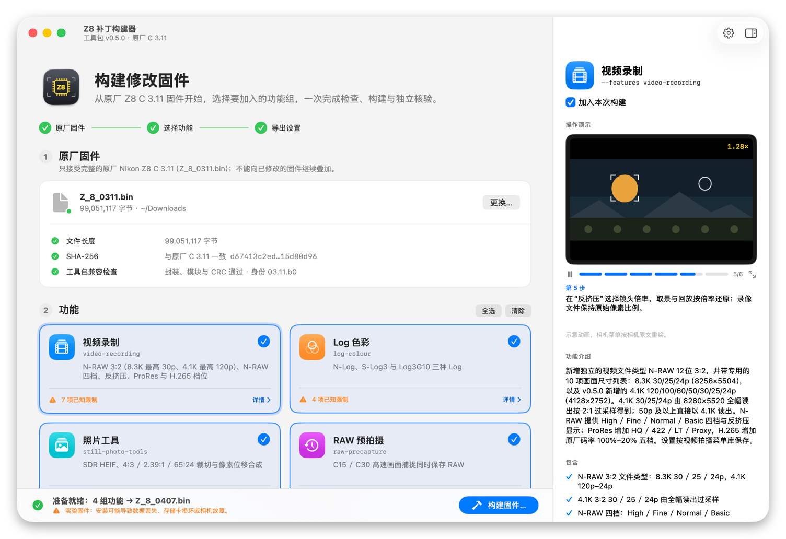
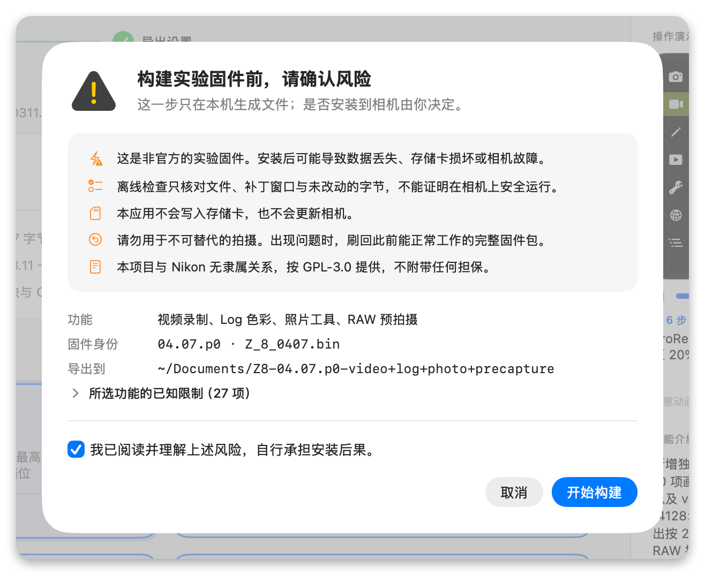
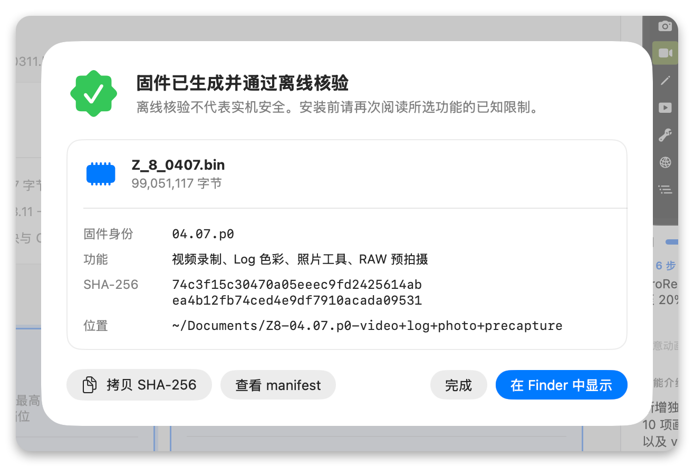
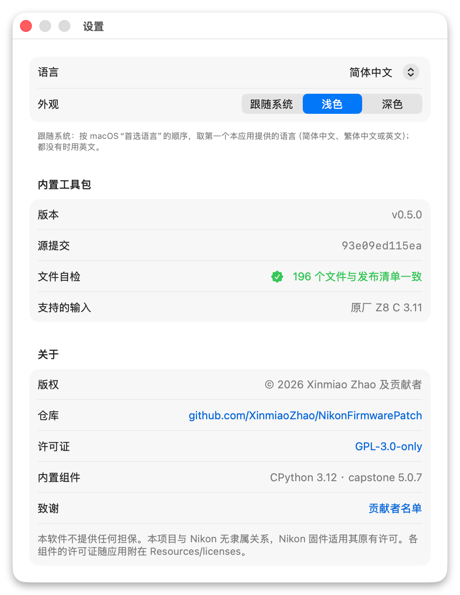
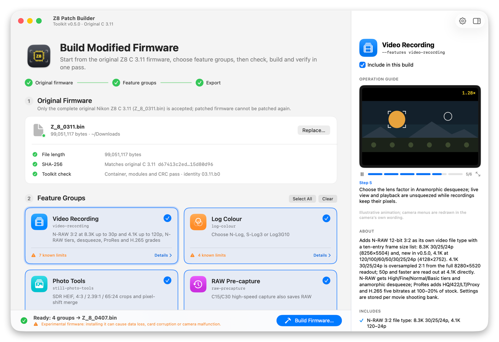
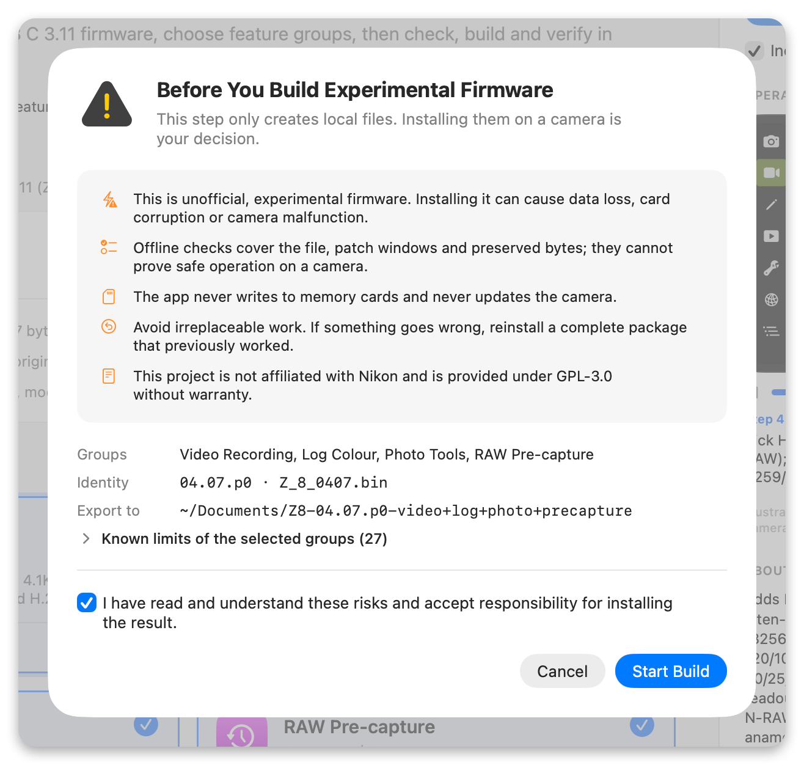
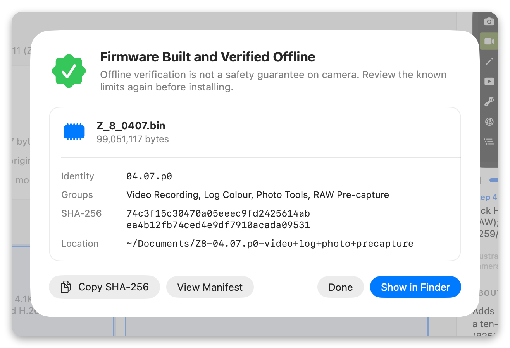
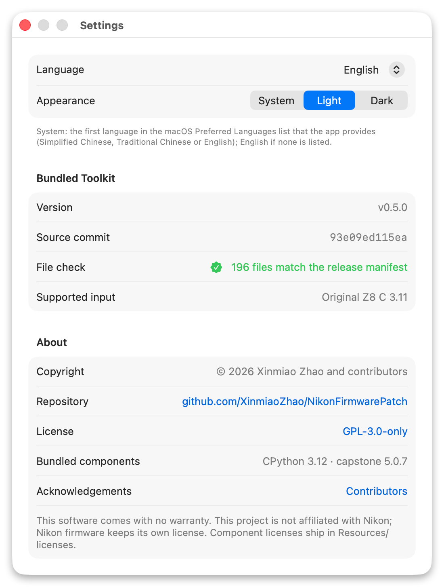

# Z8 补丁构建器（Mac app）/ Z8 Patch Builder for Mac

[简体中文](#简体中文) · [English](#english)

## 简体中文

### 概述

Z8 补丁构建器是本项目命令行工具的 macOS 图形界面，不另写构建逻辑。应用内置与同一版工具包逐字节相同的运行文件，以及一个精简的 Python。它依次调用以下步骤：

1. `patch.py --check` 检查输入；
2. `patch.py` 构建；
3. `verify.py` 独立核验；
4. 重新读取输出，与清单比对。

输入、功能和固件身份相同时，生成的 `.bin` 与命令行逐字节一致。应用只在本机生成文件，不写存储卡，也不更新相机。

### 系统要求与安装

- 需要 Apple 芯片的 Mac，macOS 14 或更高。Intel Mac、Windows 和 Linux 请使用[命令行工具包](../README.md)。
- 从 [GitHub Releases](https://github.com/XinmiaoZhao/NikonFirmwarePatch/releases) 下载 `NikonFirmwarePatch-<版本>-macOS.dmg`，可以用同一页的 `SHA256SUMS.txt` 核对。打开磁盘映像，把“Z8 补丁构建器”拖到“应用程序”。
- 应用使用 Developer ID 签名，并经过 Apple 公证，可以直接打开。
- 不需要另装 Python。只有在高级选项中选择“从源码编译”时，才需要 Xcode 或命令行工具。
- 界面提供简体中文、繁體中文（台湾用语）和英文，默认跟随系统，可在设置中切换。

### 使用步骤

1. **添加原厂固件。** 把 `Z_8_0311.bin` 拖进窗口，或点“选择文件…”。应用先核对文件长度和 SHA-256，再运行工具包的兼容检查。只接受完整的原厂 Z8 C 3.11；C 3.12、下载不完整或已经打过补丁的文件会被拒绝。官方下载地址见 [README](../README.md)。
2. **选择功能。** 左侧四张功能卡片可以单独勾选，也可以任意组合，也可以全选。点按卡片，右侧检查器显示所选功能的：
   - 功能介绍；
   - 相机中的入口；
   - 操作演示动画；
   - 已知限制。
3. **填写导出设置。**
   - 版本号格式为 NN.NN（如 04.08），内部标记为一个小写字母加一位数字（如 p0），两者组成相机中显示的固件身份 `04.08.p0`。
   - 不同的功能组合请使用不同的版本号，以便在相机菜单中区分。若这台 Mac 曾用同一身份构建过另一组功能，应用会提示换号。
   - 00.xx 只用于离线测试，不能作为上机包。
   - 最后选择导出位置。
4. **构建。** 点“构建固件…”。阅读风险说明并勾选确认后，点“开始构建”。应用依次显示四步：检查输入、构建固件、独立核验、读回校验。构建本身约 5–10 秒。

   
5. **查看结果。** 完成后可以在 Finder 中显示输出、查看 manifest、拷贝 SHA-256。

   

### 输出

每次构建都在导出位置新建一个文件夹，名称由身份和所选功能组成，如 `Z8-04.08.p0-video+photo`。同名文件夹已存在时自动加序号，不会覆盖输入或此前的输出。文件夹内有：

- 修改后的固件，按版本号命名，如 `Z_8_0407.bin`；
- `manifest.json`：输入、所选功能、固件身份、修改范围和各文件的哈希；
- `SHA256SUMS.txt`。

与命令行的输出相比，`manifest.json` 只有 `source_hashes` 一项不同。这一项列出构建时所用的工具文件，而应用只内置运行所需的部分。

取消构建会删除本次未完成的输出。独立核验或读回校验未通过时，固件会改名为 `.bin.unverified`，以免误装；这样的结果不能安装。

### 高级选项与设置

- **补丁代码来源。** 默认是“预编译单元（推荐）”，使用工具包内经审阅的预编译单元，不需要编译器。选择“从源码编译”时，应用先检测编译器版本。审阅时使用的是 Apple clang 21.0.0（clang-2100.1.1.101）；其他编译器必须产生相同的字节、符号与入口地址，否则构建会停止。
- **设置。** 可以选择语言、外观（跟随系统、浅色、深色），并查看内置工具包的版本、源提交和文件核对结果，以及版权、仓库、许可证和致谢。“关于”窗口显示应用版本、工具包版本与源提交、仓库链接和版权。
- **启动自检。** 每次启动时，应用按 `release-manifest.json` 核对内置工具包的每个文件。有缺失或改动时禁用构建，请从 GitHub Releases 重新下载应用。

### 已知限制

- 操作演示是示意动画。相机菜单按相机原文重绘，不是实拍画面；预拍信息栏和回放文件名做了简化。
- 日志按段显示命令行工具的输出，没有逐项进度条。
- 在设置中换语言后，窗口内文字立即切换；菜单栏和汉字字形要点“重新启动”后才切换。
- 跟随系统时，香港、澳门的繁体中文和粤语显示为繁體中文（台湾用语）。
- 离线核验只检查文件、补丁窗口与未改动的字节，不能证明在相机上安全运行。安装前请阅读所选功能的[已知问题](known-issues.md)。

## English

### Overview

Z8 Patch Builder is a macOS front end for this project's command-line tools; it does not reimplement the builder. The app bundles the runtime files of the same release's toolkit byte for byte, together with a trimmed Python. It runs these steps in order:

1. `patch.py --check` checks the input;
2. `patch.py` builds;
3. `verify.py` verifies independently;
4. the output is read back and compared with its checksum files.

With the same input, groups and identity, the `.bin` is byte-identical to the command line's. The app only creates local files; it never writes to memory cards or updates a camera.

### Requirements and installation

- A Mac with Apple silicon running macOS 14 or later. On Intel Macs, Windows and Linux, use the [command-line toolkit](../README.md#english).
- Download `NikonFirmwarePatch-<version>-macOS.dmg` from [GitHub Releases](https://github.com/XinmiaoZhao/NikonFirmwarePatch/releases) and, if you like, check it against `SHA256SUMS.txt` on the same page. Open the disk image and drag Z8 Patch Builder to Applications.
- The app is signed with a Developer ID and notarized by Apple, so it opens normally.
- No Python installation is needed. Xcode or the Command Line Tools are needed only for Compile from source in the advanced options.
- The interface is in Simplified Chinese, Traditional Chinese (Taiwan usage) and English. It follows the system language by default and can be changed in Settings.

### Steps

1. **Add the original firmware.** Drop `Z_8_0311.bin` on the window or click Choose File…. The app checks the length and SHA-256, then runs the toolkit's compatibility check. Only the complete original Z8 C 3.11 is accepted; C 3.12, incomplete downloads and patched files are refused. See the [README](../README.md#english) for the official download.
2. **Choose feature groups.** Tick any of the four cards on the left, in any combination, or select all. Selecting a card shows its details in the inspector on the right:
   - description;
   - camera controls;
   - operation guide animation;
   - known limits.
3. **Fill in the export settings.**
   - The version uses the format NN.NN (for example 04.08). The internal tag is one lowercase letter and one digit (for example p0). Together they form the identity shown on the camera, `04.08.p0`.
   - Give different selections different versions so they can be told apart in the camera menu. If this Mac has already built a different selection with the same identity, the app suggests another version.
   - 00.xx is reserved for offline tests and must not be installed.
   - Finally, choose the export location.
4. **Build.** Click Build Firmware…. Read the risk notice, tick the acknowledgement and click Start Build. The app shows four steps: Check input, Build firmware, Verify independently and Read back. The build itself takes about 5–10 seconds.

   
5. **Review the result.** When it finishes, you can show the output in Finder, view the manifest or copy the SHA-256.

   

### Output

Each build creates a new folder at the export location. The folder name combines the identity and the selected groups, for example `Z8-04.08.p0-video+photo`. A number is appended when that name exists; the input and earlier outputs are never overwritten. The folder holds:

- the modified firmware, named after the version, such as `Z_8_0407.bin`;
- `manifest.json`, with the input, selected groups, identity, edited ranges and file hashes;
- `SHA256SUMS.txt`.

Compared with the command line's output, only the `source_hashes` entry of `manifest.json` differs. It lists the tool files used for the build, and the app bundles only the files needed to run.

Cancelling removes the incomplete output. If independent verification or the read-back fails, the firmware is renamed to `.bin.unverified` so it cannot be installed by mistake; such a result must not be installed.

### Advanced options and settings

- **Patch code.** Prebuilt units (recommended) is the default. It uses the reviewed prebuilt units in the toolkit and needs no compiler. Compile from source first checks the compiler version. The units were reviewed with Apple clang 21.0.0 (clang-2100.1.1.101); any other compiler must reproduce the same bytes, symbols and entry points or the build stops.
- **Settings.** Choose the language and appearance (System, Light or Dark), and see the bundled toolkit's version, source commit and file check, plus the copyright, repository, license and acknowledgements. The About window shows the app version, the toolkit version and source commit, the repository link and the copyright.
- **Start-up check.** At every launch the app checks each bundled toolkit file against `release-manifest.json`. If any file is missing or changed, building is disabled; download the app again from GitHub Releases.

### Known limits

- The operation guides are illustrative animations. Camera menus are redrawn in the camera's own wording and are not camera footage; the pre-capture info bar and playback file names are simplified.
- The log shows the tools' output in blocks, without a per-step progress bar.
- After changing the language in Settings, the window switches at once; the menu bar and Han glyph forms switch only after Relaunch.
- With the system setting, Traditional Chinese for Hong Kong and Macau and Cantonese use Traditional Chinese (Taiwan usage).
- Offline verification covers the file, patch windows and preserved bytes; it cannot prove safe operation on a camera. Read the [known issues](known-issues.md) of the selected groups before installing.

## 相关文档 / Related documents

[构建与截图 / Build and screenshots](../README.md) · [发布附件 / Release assets](releases.md) · [已知问题 / Known issues](known-issues.md) · [致谢与许可 / Attribution](../NOTICE.md)
